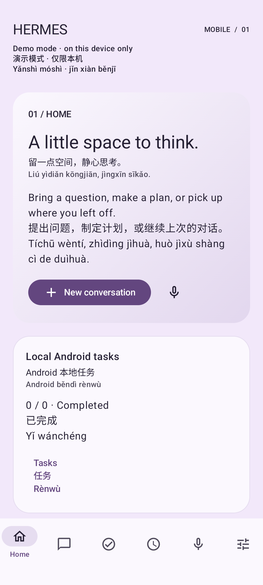
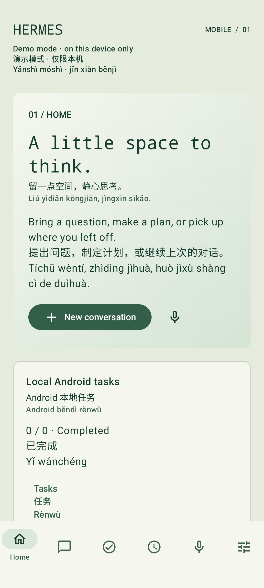
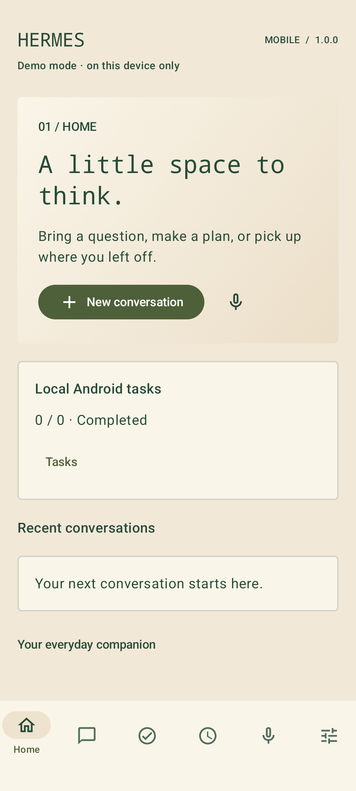
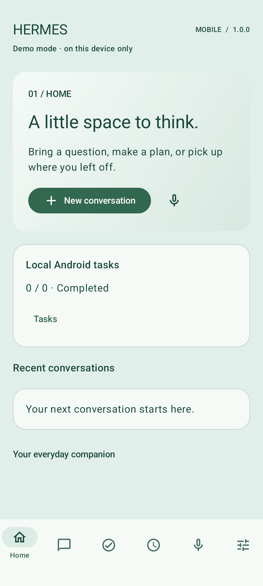

# Hermes Agent Mobile

An unofficial, open-source native Android client for [Hermes Agent](https://github.com/NousResearch/hermes-agent). Your agent runs on your infrastructure; the phone is its companion.

**0.3.0 · Android 8.0+ (API 26) · Kotlin · Jetpack Compose · MIT**

Independent community project. Not affiliated with or endorsed by NousResearch. Hermes Agent is a separate project.

## A calm place for your agent

Four interchangeable palettes, persistent conversations, English / Simplified Chinese / accented pinyin, local tasks, read-only scheduled jobs, and push-to-talk transcription.

| Lavender Original | Jade Terminal | Solar Archive | Mint Circuit |
| --- | --- | --- | --- |
|  |  |  |  |

Actual Android 16 emulator screenshots in Demo mode. [Chat, tasks and tablet screenshots](docs/screenshots.md) · [Validation results](docs/VALIDATION.md) · [Original design preview](docs/design-preview.svg).

Get the installable debug APK from the [development release](https://github.com/DionCroft/hermes-agent-android/releases/tag/v0.3.0). Local build output is `app/build/outputs/apk/debug/app-debug.apk`.

## Features

- Native Compose UI with phone navigation and a navigation rail on larger displays. Edge-to-edge layout, selectable Markdown/code blocks, copy, timestamps, conversation switching.
- Lavender Original, Jade Terminal, Solar Archive, Mint Circuit. Independent theme engine, live selection, reduced-motion preference, system font scaling. Retro palettes use forest-green text. No bundled fonts.
- Independent English, Chinese and pinyin strings. Pinyin can be hidden without hiding Chinese. Agent responses are never translated automatically.
- Trusted HTTPS with bearer authentication. AES-GCM token encryption backed by Android Keystore; no certificate bypass, redirects or HTTP request logging. Path prefixes such as `/p/work/` are preserved.
- Capability discovery. Native server sessions where supported; Runs API for resumable streams and explicit status; native session streams on older installs; OpenAI-compatible completion fallback.
- Durable local turn keys for safely retrying Runs submission. Connection interruptions show **unknown** until checked. Assistant finalisation never implies run completion. Compatibility streams say **response received / run outcome unavailable**.
- Persisted tool activity with timestamps/duration and visible previews. Durable allow-once / deny approvals and explicit clarification answers verify current prompt identity/generation/content. Uncertain delivery never automatically retries a decision. Demo includes harmless exercises.
- Room tasks: create, edit, complete, delete, notes, title/notes search, open/completed/overdue filters, priority and ISO due date, with real local progress.
- Hermes scheduled jobs: list and fetch details, enabled state and supplied run timestamps. Profile-partitioned snapshots remain available offline with stale indicators. No server job editing controls yet.
- Foreground speech recognition defaults to on-device-only, with explicit microphone permission, English/Chinese input and editable transcription transferred to Chat for review. Optional read-aloud supports installed language voices, speed and stop. Network voices require opt-in. Audio stops when leaving Voice or backgrounding.
- Explicit **Demo mode**, enabled initially. Sample text and job are labelled; no network requests are made by the fake client. Demo and real conversation storage are separated.

See [0.3.0 release evidence](docs/releases/0.3.0.md) for voice, decisions and recovery validation; [0.2.0](docs/releases/0.2.0.md) covers session/task/cache improvements.

## Build

Use JDK 24 (CI), Android SDK Platform 37 and Build Tools 36.0.0. Gradle 9.8.2 is provided by the wrapper. Source/bytecode target is Java 17.

```sh
./gradlew assembleDebug testDebugUnitTest lintDebug
```

On Windows, use `gradlew.bat`. Set `ANDROID_HOME` or an untracked `local.properties` with `sdk.dir`. The debug APK is `app/build/outputs/apk/debug/app-debug.apk`. Release builds are unsigned; release signing is intentionally not configured.

For an E:-only Windows tool/cache/temp setup:

```powershell
.\scripts\build-windows.ps1 -WorkRoot E:\Temp\hermes-mobile -AndroidSdk E:\Android\Sdk
```

See [development](docs/DEVELOPMENT.md) for the toolchain, tests, emulator and directory rules. Build reports are local generated artifacts and are not committed.

## Connect your Hermes

1. Enable Hermes' API server on the existing host; its default host binding is `127.0.0.1:8642`.
2. Make it reachable through a private VPN and a trusted HTTPS reverse proxy. Do not expose its raw port publicly.
3. In Settings enter the server root, e.g. `https://agent.example.net/p/work/`, and its bearer token. The app appends API paths while retaining your prefix.
4. Tap **Save & test connection**. The settings become active only after an authenticated discovery request succeeds. Empty token retains the saved credential only for the same URL.
5. Start Chat. Imported sessions are restricted to `api_server` ownership. CLI/Desktop conversations need upstream shared-session protocols and are outside this alpha.

`127.0.0.1` on Android is the **phone**, not your computer. Cleartext testing requires both the debug build and an explicit Settings toggle. Release builds always require HTTPS. A token can grant terminal/tool access: protect it as a powerful credential.

For Demo, leave Demo mode enabled. You can explore themes, local tasks, sample streaming and the sample job without a Hermes installation. To use your saved server again, disable Demo or save/test the connection.

See [connection details](docs/HERMES_CONNECTION.md) and the [official API reference](https://hermes-agent.nousresearch.com/docs/user-guide/features/api-server/).

## Known limits

- Development release. Real-server interoperability requires testing against your specific Hermes install. The project does not include a live server or credentials.
- No background monitoring, notifications, widgets, full-duplex voice, file attachments or job mutation UI yet.
- A dropped stream does not mean the server stopped. Use Check / recover run; a run with a known ID is queried without resubmission. No run ID on a non-Runs transport means automatic resending is deliberately unavailable.
- Run streams are not automatically reattached after process death. Check / recover run uses the saved ID and sequence cursor without creating new work. Replay gaps use status-only recovery. Hermes may expire event buffers/status records; unknown outcomes may require server review.
- Legacy OpenAI-compatible chat has local history only and no authoritative run outcome. It does not advertise cancellation unless a usable run ID/control exists.
- The conversation browser searches loaded local records and loads additional server pages explicitly. Selecting/refreshing settled API sessions synchronizes saved history atomically; active/unknown turns retain their receipts. A history beyond 100,000 server rows produces an explicit limit error and keeps the cache. Server compression continuation IDs are retained.
- Conversations/tasks use Android app-private Room storage, **not database encryption**. Backups/transfer are excluded. The token alone is Keystore encrypted. Clear local cache does not delete server history or tasks.
- Only system-provided fonts are used. Theme typography/outlines differ, with restrained gradients and no ornamental animations. Actual UI labels and pinyin wrap; compact navigation retains English labels and multilingual accessibility descriptions.
- Speech recognition availability and accuracy depend on the Android service. On-device-only mode fails closed when no local recognizer is available; system recognition may use the network when that mode is explicitly disabled.

## Contributing

See [CONTRIBUTING](CONTRIBUTING.md), [architecture](docs/ARCHITECTURE.md), [theme guide](docs/THEMING.md), [security policy](SECURITY.md), [roadmap](ROADMAP.md) and [changelog](CHANGELOG.md). Bugs and feature requests have issue templates. Original code is MIT; third-party notices are in [NOTICE](NOTICE.md) and in Settings.
