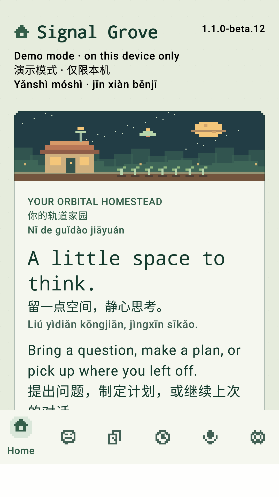
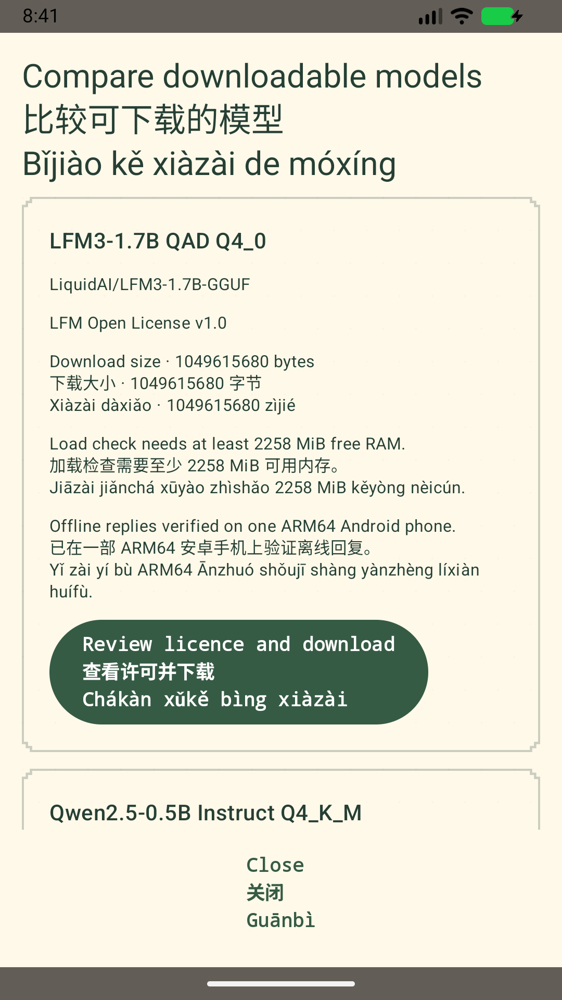

<h1 align="center">Signal Grove</h1>

<strong>An open-source Android companion for Hermes Agent</strong>

  Follow your agent from your phone, or load a compatible model for a separate offline chat.
  Original pixel art, five themes, and English, Simplified Chinese and pinyin.

  <a href="https://github.com/DionCroft/Signal_Grove/releases/download/v1.1.0-beta.12/hermes-agent-mobile-1.1.0-beta.12.apk"><strong>Download beta.12 preview APK</strong></a>
  · <a href="https://github.com/DionCroft/Signal_Grove/releases/tag/v1.0.0">Stable release</a>
  · <a href="docs/SETUP_GUIDE.md">Setup guide</a>

  
  

<em>Beta.12 Demo home and beta.10 phone model catalogue.</em> <a href="docs/screenshots.md">More screenshots</a>

## Install or update

Signal Grove runs on **Android 8.0 and later**. It is an independent community app for [Hermes Agent](https://github.com/NousResearch/hermes-agent).

| Channel | Version | Download |
| --- | --- | --- |
| **Preview** | **1.1.0-beta.12**, version code 117 | [Production APK](https://github.com/DionCroft/Signal_Grove/releases/download/v1.1.0-beta.12/hermes-agent-mobile-1.1.0-beta.12.apk) · [Release notes and checksums](https://github.com/DionCroft/Signal_Grove/releases/tag/v1.1.0-beta.12) |
| **Stable** | **1.0.0** | [Production APK](https://github.com/DionCroft/Signal_Grove/releases/download/v1.0.0/hermes-agent-mobile-1.0.0.apk) · [Release notes and assets](https://github.com/DionCroft/Signal_Grove/releases/tag/v1.0.0) |

For an in-place update, install the matching production APK over your existing production installation. Matching the package and signing key preserves its data. Preview builds with the updater can check **Settings → App updates**. Enable **Include preview releases** to find betas, review the download, and confirm the installation in Android. [Update and migration guide](docs/APP_UPDATES.md)

## Get started

1. **Explore in Demo mode.** It starts enabled on a fresh installation. Try the interface, chat, tasks and sample approvals without a Hermes server. [User guide](docs/USER_GUIDE.md)
2. **Connect your Hermes server.** Use its authenticated API over trusted HTTPS, for example through a private Tailscale network. In **Settings → Server**, enter the API root and bearer token, then tap **Save & test connection**. Management features use a separate dashboard sign-in. [Full connection guide](docs/SETUP_GUIDE.md)
3. **Try offline chat.** In the preview, open **Settings → On-device AI → Phone models**. Review a catalogue model's licence or import a compatible GGUF file, then tap **Load**. You’ll need a supported 64-bit device, enough memory and storage, and a separately installed model. Phone chat has its own history. [Model and offline chat guide](docs/ON_DEVICE_AI.md)

## What you can do in beta.12

| Area | How it helps |
| --- | --- |
| **Follow Hermes conversations** | Stream replies and browse existing history. See which tool is open and the reported MCP server, skill, subagent outcome, model and provider. Automatic model selection can follow the verified serving model. |
| **Work offline on your phone** | Open offline setup from the phone composer. Generate locally, review prompt fit, edit or branch a chat, search history, and export or back it up. The production LFM3 context is 4K. |
| **Review work before it runs** | Follow approval requests, browse bounded read-only workspace previews, and review upcoming schedules, time-zone offsets and scoped run receipts where supported. |
| **Make it yours** | Use built-in phone tasks, a task widget, five pixel-art themes, scalable text and reduced motion. Dictation and read-aloud use Android’s installed speech services. |

Hermes controls depend on the connected runtime, authentication, and configured capabilities. Workspace browsing also needs an enrolled worker. The [compatibility guide](docs/COMPATIBILITY.md) and [feature matrix](docs/FEATURES.md) explain availability by area.

## Release verification

The beta.12 APK is **76.6 MB**. Its exact release commit on main passed **1,256 JVM tests**, **1,263 Android 8** cases and **1,264 Android 17** cases. The original-key Xiaomi upgrade retained the installation, saved Hermes connection and an existing conversation verified in both history samples. The public APK, checksums, signing certificate, runtime SBOM and build provenance were downloaded and verified. [Beta.12 verification](docs/releases/1.1.0-beta.12.md) · [Full validation evidence](docs/VALIDATION.md)

## Help and development

- **Using Signal Grove** · [Setup](docs/SETUP_GUIDE.md) · [On-device AI](docs/ON_DEVICE_AI.md) · [Management](docs/MANAGEMENT.md) · [Troubleshooting](docs/DEVICE_DIAGNOSTICS.md)
- **Project status** · [Changelog](CHANGELOG.md) · [Roadmap](ROADMAP.md) · [Open audit items](docs/AUDIT_EXECUTION_PLAN.md)
- **Contributing** · [Development guide](docs/DEVELOPMENT.md) · [Contributing guide](CONTRIBUTING.md) · [Report a bug](https://github.com/DionCroft/Signal_Grove/issues/new/choose) · [Report a security issue](SECURITY.md)

The app uses Kotlin and Jetpack Compose. Use JDK 24 and the checked-in Gradle wrapper.

~~~sh
./gradlew testDebugUnitTest lint assembleDebug assembleDebugAndroidTest
~~~

On Windows, use the [snapshot build wrapper](scripts/build-windows.ps1) with tools and temporary files on the E drive.

~~~powershell
.\scripts\build-windows.ps1 -WorkRoot E:\Temp\hermes-mobile -AndroidSdk E:\Android\Sdk
~~~

[MIT licence](LICENSE) · [Third-party notices](NOTICE.md)
