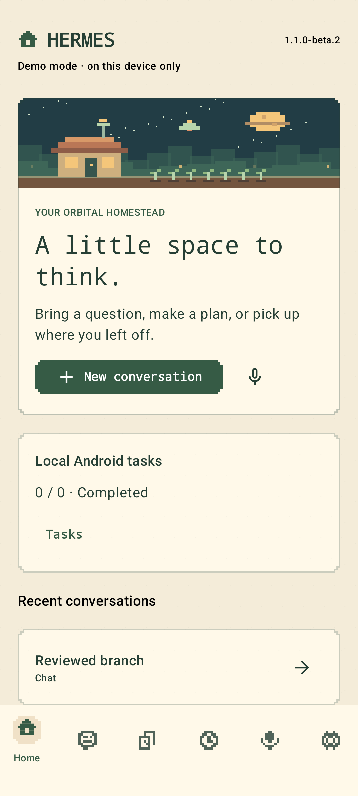
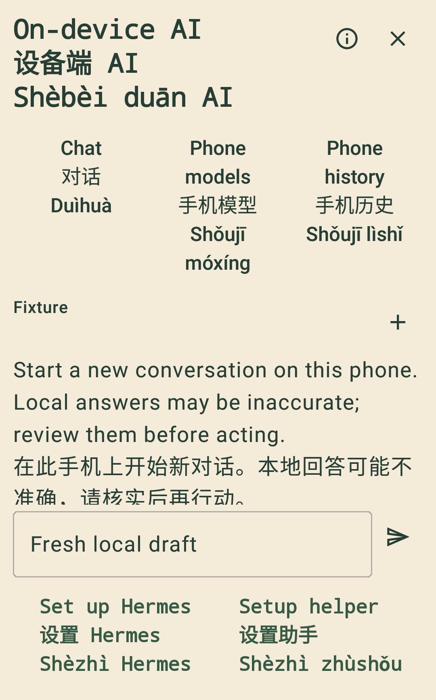

# Signal Grove

An unofficial, open-source Android companion for [Hermes Agent](https://github.com/NousResearch/hermes-agent), with a pixel-art interface and optional on-device text AI in the beta.9 preview. Hermes runs on your infrastructure; local phone conversations keep their own model and history.

**Beta.9 is available:** the experimental prerelease includes optional offline
AI, model management and the grounded setup helper. Its seven selected native
phone methods have positive evidence; incomplete compatibility and final
production-phone acceptance remain disclosed. The wider audit is paused at the owner's request with every acceptance priority retained.
[Download beta.9](https://github.com/DionCroft/Signal_Grove/releases/download/v1.1.0-beta.9/hermes-agent-mobile-1.1.0-beta.9.apk)
· [Published evidence and limitations](docs/contracts/2026-11-13-beta9-public-preview.md)
· [Paused goal](docs/GOAL.md) · [Completed and incomplete tasks](docs/audits/2026-11-15/PAUSED_REVIEW.md).

The latest investigation is saved on the feature branch with a failing API37
keyboard-viewport check; it is not merged or published. Main has the reviewed
SDK source fix and this paused documentation checkpoint. No newer stable APK
is qualified. Beta.9's public production download/checksum were reverified.

**Android 8.0+ · Kotlin / Jetpack Compose · Five themes · English / 简体中文 / pinyin · MIT**

The maintained SDK correction now passes **16 read-only status checks with two
real native turn receipts**: active general-chat turns are counted, and the
missing peer-context module is restored in a separate declared source copy.
Windows coverage remains **885 positive / 273 platform skips in 1,158 cases**.
The original SDK's configured freeze/drain/native-stop checkpoint remains
separate; corrected gateway-wire, concurrent snapshot and final PM checks are open.

Android sources retain **1,011 JVM tests**, **27 focused methods on each API26/
API37**, and zero lint errors (51 debug / 50 release warnings) at their recorded
snapshot. Full upstream, original API26/navigation, worker/integration and final
production acceptance remain open. Live Hermes and beta.9 are unchanged.
[Current evidence and next work](docs/contracts/2026-11-15-maintained-unbound-dependency-and-status.md).

Source `09306e6` independently passes **1,011 JVM tests, 1,142 API26 / 1,143 API37
standard device tests** and both lint variants (zero errors). Raw method unions,
summary and actual APK hashes match. Original UI causes, external-model/final
phone gates and wider interoperability remain open. Upstream review retains
**37 stable / 172 inspected-main findings** at its recorded revisions.
[Current evidence and remaining work](docs/contracts/2026-11-15-gateway-fence-owner-and-android-review.md).

## Download and release status

| Version | Status | Install |
| --- | --- | --- |
| [1.0.0](https://github.com/DionCroft/Signal_Grove/releases/tag/v1.0.0) | Published stable community release | [Release assets](https://github.com/DionCroft/Signal_Grove/releases/tag/v1.0.0) |
| [1.1.0-beta.8](https://github.com/DionCroft/Signal_Grove/releases/tag/v1.1.0-beta.8) · code 111 | Published preview: serving-model selection, reasoning/service presets, existing chats and stored projects | [Download production APK](https://github.com/DionCroft/Signal_Grove/releases/download/v1.1.0-beta.8/hermes-agent-mobile-1.1.0-beta.8.apk) |
| [1.1.0-beta.9](docs/releases/1.1.0-beta.9.md) · code 114 | Published experimental preview: offline AI, model management, setup helper and packaging improvements; full acceptance remains open | [Download production APK](https://github.com/DionCroft/Signal_Grove/releases/download/v1.1.0-beta.9/hermes-agent-mobile-1.1.0-beta.9.apk) |

The table below describes current `main`; release notes define what is included in each published APK. Production and debug are separate packages with separate signing keys. Upgrade the matching package to preserve its data; see [installation and migration](docs/USER_GUIDE.md). The [approved GitHub updater](docs/APP_UPDATES.md) requires your download/install approval, validates the APK and preserves active-work guards. Enable **Include preview releases** to discover betas.

[Brand and upgrade compatibility](docs/BRANDING.md) · [Changelog](CHANGELOG.md) · [Roadmap](ROADMAP.md) · [Full audit](docs/AUDIT_EXECUTION_PLAN.md)

Independent community project; not affiliated with or endorsed by NousResearch. Original pixel art and system fonts; no copied game assets.

The [offline-LLM feature backlog](docs/ON_DEVICE_AI_BACKLOG.md) now includes
planned chat editing/branching, searchable history, context/performance controls,
model-library improvements and personal offline tools. These additions are
planned while the goal is paused; they are not features of the current APK.

## Features on main

| Area | What is implemented | Details |
| --- | --- | --- |
| Hermes chat and history | Capability-based Runs/session/compatibility transports; streaming, conversation search/paging, model choices, session locks/forks/steering, tool/subagent activity and reviewed approvals | [Protocol scope](docs/COMPATIBILITY.md) |
| Serving-model awareness | Distinguish the verified serving model, server default and conversation selection. Automatic follows the freshly verified serving model for new turns; reasoning/service use presets | [Model status/setup](docs/RUNTIME_MODEL_STATUS.md) |
| Optional on-device AI | Separate offline text chat/history, streamed cancellable generation, context/load/unload/delete controls, pinned LFM3 download and compatible GGUF import | [Usage and current limits](docs/ON_DEVICE_AI.md) |
| Setup and troubleshooting | Static setup guide works without a model; the optional helper selects versioned source-backed checks for setup, network, authentication, models, history and projects | [Set up Hermes](docs/SETUP_GUIDE.md) |
| Conversations and projects | Canonical read-only conversation viewer, hosted room browsing, stored project management and project-conversation navigation | [Feature and validation matrix](docs/FEATURES.md) |
| Host management | Reviewed provider/device-code accounts, credential pools, fallback chains, custom endpoints, MCPs, plugins, skills, channels and Kanban controls | [Management scopes](docs/MANAGEMENT.md) |
| Tasks and automation | Phone tasks with notes, filters, due dates/priorities and reviewed JSON transfer; opt-in supported Hermes scheduled-job controls | [User guide](docs/USER_GUIDE.md) |
| Voice and notifications | Foreground dictation/read-aloud through installed Android services; opt-in task/run monitoring and task-count widget | [Compatibility](docs/COMPATIBILITY.md) |
| Pixel interface | Starhaven Grove, Lavender Original, Jade Terminal, Solar Archive and Mint Circuit; stepped panels/icons, original animations, phone/tablet navigation, reduced motion and scalable text | [Themes](docs/THEMING.md) |
| Private connections and updates | Trusted HTTPS, profile path prefixes, Keystore-backed credential encryption, exact review of sensitive effects and signed, checksum-verified APK updates | [Security](SECURITY.md) |

A feature being implemented does not establish interoperability with every Hermes install. Controls depend on advertised server capabilities and authentication. Remote project metadata does not establish a worker's execution location. [Detailed implementation/validation boundaries](docs/FEATURES.md).

## Current figures

Checked **15 November 2026**. Counts describe their stated builds and test scopes; they are not combined into a single completion score.

| Check or measurement | Verified result | Scope |
| --- | ---: | --- |
| Maintained SDK unbound-status component | **16 read-only checks / two real turn receipts** | Corrected declared SDK copy; includes five expected UNKNOWN outcomes and idle second profile; not gateway/fleet/PM acceptance |
| Prior original-SDK gateway lifecycle | **Freeze/drain/native stop verified in its configured home** | Source `6e1325b` fixture, original SDK/dependency baseline and profiler scope; corrected SDK gateway-wire/fleet acceptance remains open |
| New fixture boundary methods | **10 / 10 on Pi and Windows** | Negative scope/epoch/admission/read-only command guards; overlaps full policy counts |
| Current Windows policy suite | **885 passes / 273 platform skips** | 1,158 distinct cases in this chunk; new native component observations are separate |
| Previous controlled Pi cohort | **104 methods / no skips** | Eight native gateway cases plus existing PM/backup/retirement coverage; four-mode SDK trial separately verifies eight requests |
| Last independently reviewed hosted policy suite | **1,158 methods / no skips** | Source `4e66626`; exact positive raw inventory, stopped native unit and Windows/native inventory match |
| Current local JVM tests | **1,011 cases / 97 reports** | Snapshot `b117ab22dba47ca6`; actual XML, no failures/errors/skips; hosted `09306e6` separately retained |
| Focused workspace/native-tap device checks | **27 methods on each API / no skips** | API26 + API37, same verified APKs; actual late-keyboard transition and single native input, not full device acceptance |
| Current HTTPS cancellation | **3 ms phone / 18-34 ms emulator** | Two initial cancellation observations per device; see the separate full foreground-resume result |
| Full foreground LFM3 resume | **27,010 ms** | One physical phone case: explicit resume, full 1,049,615,680-byte hash/metadata check and atomic install; not a speed guarantee |
| Physical process/restart recovery | **2 positive cases; 2.849 / 1.856 s JUnit** | Original cold/post-reboot methods on the owner phone; one approved normal restart, no automatic load/replay, original data retained; preparation intentionally interrupted |
| Stable native-auth/startup fixture | **87 / 87 cases** | Exact stable3b42157; real ASGI, loader helpers and start-entry/PM suppression with explicit adapters; not full backend, live Pi or complete socket acceptance |
| Current stable canonical authority | **46 authority/wire +13 attach-first cases** | Separate real-source flows with synthetic actors/transports; strict schemas and replay/no-replay guards, not full socket/live acceptance |
| Unmodified native owner room reads | **20 checks** | Real Windows owner tickets/sockets, synthetic room data; original empty mode retained; both report the open shutdown finding |
| Portable compatibility and Windows workspace checks | **513 portable / 15 runtime-model / 72 Windows native cases** | Pinned client correction is live; five normal Pi reads and same daemon/receipts verified; native app-auth/phone/NAS acceptance remains open |
| Repository HTTP coordinator binding | **16 transport / 18 native authority cases** | Owner-approved source fix; actual PKCE/tickets/TCP with synthetic worker; Pi/native Android deployment acceptance and SDK shutdown remain open |
| Actual staged Pi owner transport | **16 coordinator outcomes / 50 protocol assertions** | Native UID + synthetic-IdP HTTP PKCE/refresh/tickets/WS and exact workspace receipts; zero fence refusals, lifecycle warning holds the overall gate; no live activation |
| Exact upstream plugin install | **17 canonical cases / 4 files** | Pristine v0.23.1; reviewed source moves/commit/catalog/exists refusals. Separate full RPC file now has six canonical Linux positives, including POSIX host; exact source/artifact verified |
| Optional protected operator binding | **8 portable / 8 Linux native policy cases** | Explicit grants, fixed routes and fresh file-generation checks. Exact-source Linux/Windows artifacts verified; no Pi deployment |
| Backup archive content component | **26 Pi methods; earlier SDK/age fixture** | Exact members/hash/CRC and SQLite integrity; Windows creation-time fix plus 250 fresh images. Earlier fixture verifies two WAL rows and crypto round-trip; full transaction remains open |
| Private backup publication component | **32 Pi methods** | Actual journal/manager/path boundary with loopback GitHub protocol and prior SDK/age ciphertext; once-only effects and downloaded bytes verified, real private GitHub acceptance remains open |
| Earlier backup-stage implementation | **97 Pi cohort methods + one actual SDK/age stage** | Generated state/disposable key, two WAL rows and loopback private publication; independently reconstructed specification and crypto/SQL readback. Real private GitHub/live-home/external-provider acceptance remains open |
| Shared operational directory boundary | **208 Pi methods + one actual guarded install** | Ten roles, guarded journal and PM, shared actual mode/parent witnesses; independent raw/native review. Component cohorts overlap; canonical provisioning and full transaction remain open |
| Native PM preparation component | **48 Pi cases + one actual install** | Separate fresh private home, supported full install/currency, four activation inputs and ARM64 imports; independently verified. Includes 25 overlapping service cases; canonical provisioning and full cutover remain open |
| Current Pi source preservation | **79 live paths unchanged / 18 native authority outcomes** | Isolated ARM64 PM candidate built with only vendor-path rebase; same cases pass on Windows/Pi. Live activation and both permission prerequisites remain open; [exact scope](docs/contracts/2026-11-14-native-arm64-staged-candidate.md) |
| Official shutdown regression cohorts | **50 cases each: pristine and candidate** | Exact stable3b plus the reviewed two-file candidate; six canonical no-retry file runs, identical cases, immutable sources; original owner-runtime warning stays open |
| Experimental heartbeat candidate | **8 helper cases; 3 explicit native owner trials** | Exact 3b42157 + two-file patch, default-off reproducible mode; 1.219 s held-writer close fence; not deployed or accepted as unmodified upstream |
| Current hosted lint | **0 errors**; 52 debug / 51 release warnings | Source 09306e6, both actual XML reports; warnings retained |
| Earlier candidate Android 8.0 UI | **10 / 10 passed** | Local-AI UI, consent/helper review and bilingual large text; synthetic state |
| Physical offline model tests | **6 / 6 passed** | Earlier original-key debug candidate on an ARM64 Android 17 phone; LFM3, Qwen and grounded helper |
| Current selected offline methods | **7 have positive evidence** | Unchanged code114 source0ee app, separately identified companions; garden/metadata/helper/generation/Qwen/switch/import; not the full external-model gate; old failures retained |
| Current workspace Review regression | **31 / 31 API26 cases** | Native UI, rendered-outline counterexamples and six scripted dispatch guards;16 acknowledged native taps, not full-suite/live acceptance |
| Latest complete standard device gate | **1,142 API26 / 1,143 API37 cases** | Source `09306e6`, four independently checked disjoint raw partitions and actual build APK hashes; external-model/final-head/phone gates remain separate |
| Physical model import observations | **649–1,438 ms** | Three observed LFM3/Qwen imports; not a speed guarantee |
| Highest observed process VmHWM in model tests | **2.43 GiB** | Short USB-charging phone tests; not a minimum-RAM requirement or sustained thermal/battery benchmark |
| Recommended LFM3 model file | **1.05 GB** | 1,049,615,680 bytes, separate licensed download; weights are not bundled |
| Published beta.9 production APK (code114) | **71.1 MB** | 71,052,938 bytes from clean0ee08e3; original signer and anonymous public download verified; final production-phone acceptance remains open |
| Runtime advisory query | **150 Maven versions; 0 known matching advisories** | OSV query on 13 November; known-indexed coverage, not a full security certification |

[Fresh reviewed-main signed candidate](docs/contracts/2026-11-12-reviewed-main-beta9-candidate.md) · [Native owner rooms and complete Android freeze](docs/contracts/2026-11-12-native-owner-room-reads.md) · [Current-stable canonical authority](docs/contracts/2026-11-12-current-stable-authority.md) · [Real loader/start-entry and complete hosted gate](docs/contracts/2026-11-12-native-loader-startup.md) · [Native workspace Review and preserved CI failure](docs/contracts/2026-11-12-native-workspace-review.md) · [Current stable auth/clean release inventory](docs/contracts/2026-11-12-current-stable-auth-release-inventory.md) · [Physical restart retention](docs/contracts/2026-11-12-physical-restart-retention.md) · [Both keyboard states](docs/contracts/2026-11-12-ready-keyboard.md) · [Earlier emulator cold recovery](docs/contracts/2026-11-12-native-cold-recovery.md) · [Full foreground phone download](docs/contracts/2026-11-12-foreground-model-download.md) · [Cancellation/build evidence](docs/contracts/2026-11-12-download-cancellation.md) · [Earlier packaging/UI evidence](docs/contracts/2026-11-12-uncompressed-dex-candidate.md) · [Physical offline evidence](docs/contracts/2026-11-12-physical-offline-model-acceptance.md) · [Prior standard gate](docs/contracts/2026-11-12-complete-standard-android-gate.md) · [Full validation history](docs/VALIDATION.md)

The [unique Chat-route evidence](docs/contracts/2026-11-13-unique-chat-route.md)
records a hosted transition failure where messages loaded while Home remained
selected. Tests now use the unique route target, click once and require Chat
selection. Fresh 16-method scopes pass independently on API26/37, including
duplicate-target/no-replay counterexamples and actual keyboard transitions.
Required checks pass 1,011 JVM cases and zero-error lint; full final-source
coverage and original API26 causes remain open. The
[earlier keyboard/upstream review](docs/contracts/2026-11-13-keyboard-gap-and-upstream-delta.md)
retains its native gap and semantic/transitive compatibility limits.

The [pipe availability investigation](docs/contracts/2026-11-13-pipe-availability.md)
retains earlier failures and the measured local busy-pipe race. The
[live read-client correction](docs/contracts/2026-11-13-live-read-client-update.md)
now passes normal installed-helper Pi reads against the same daemon, with fresh
encrypted component recovery and original receipts. Native app-auth and Android
workspace/file/NAS acceptance remain open.

The [transitive/shutdown review](docs/contracts/2026-11-13-transitive-review-and-shutdown.md)
adds source-context guards without resetting the baseline, records paired
50-case official regression cohorts and verifies the new API26 raw union.
The separate shutdown warning and final-current-head gate stay open; the complete
c814 fixture gate is reconciled below.

The [complete wrapper review](docs/contracts/2026-11-13-existing-host-client-integration.md)
records the pre-installation source/native/Pi proof and recovery plan. The
[live commissioning](docs/contracts/2026-11-13-live-read-client-update.md) records
the subsequent atomic client update without a daemon restart. The
[fresh readiness investigation](docs/contracts/2026-11-13-fresh-workspace-readiness.md)
preserves the measured refusal before native admission and c814 gate evidence.
Doctor and graph findings, native app login, phone/NAS and the wider audit remain.

The [HTTP operator binding review](docs/contracts/2026-11-13-http-operator-binding-review.md)
records the real valid-login refusal, tested unapplied proposal, retained SDK
shutdown warning and complete source 4444 Android raw/APK reconciliation.

**Still open:** final-source hosted checks, wider upstream semantic/dependency
review (37 stable and 172 inspected-main handler changes awaiting review), real project/workspace/worker,
automation/integration and final production code114 phone acceptance. Earlier
production code112 upgrade, connection/history and stored-project reads passed.
Public beta.9 remains the separately identified experimental source0ee preview.
Every remaining requirement stays in the [full audit](docs/AUDIT_EXECUTION_PLAN.md).

## Interface figures

| Pixel interface | Candidate on-device AI |
| --- | --- |
|  |  |

Left: earlier Android 16 Demo capture. Right: exact beta.9 API26 component-test capture, synthetic model/draft, bilingual text at 130% font scale. These are app captures, not generated mockups or proof of live model output. [More themes, tablet views and capture provenance](docs/screenshots.md).

## Connect to Hermes

1. Run Hermes' authenticated API server on your existing host. Its normal local binding is `127.0.0.1:8642`.
2. Reach it through a private VPN such as Tailscale and trusted HTTPS. Keep the raw API port private.
3. In **Settings → Server**, enter the API root and bearer token, then **Save & test connection**. The app preserves profile prefixes such as `/p/work/`. Complete any Android local-network permission prompt when using a private endpoint.
4. Open Chat and Conversation history. Existing Desktop/Discord conversations can be read in their selected profile; API-owned conversations support replies and advertised controls. Use explicit paging for older chats.
5. Configure the separate **Hermes management** dashboard sign-in when using management/project features. Its authentication is separate from the chat API token.

`127.0.0.1` on Android means the phone. Production requires HTTPS. The token may grant powerful agent/tool access: keep it private. Start with labelled Demo mode to explore without a server.

[Complete setup guide](docs/SETUP_GUIDE.md) · [Connection details](docs/HERMES_CONNECTION.md) · [Official API reference](https://hermes-agent.nousresearch.com/docs/user-guide/features/api-server/)

## Use on-device AI

In beta.9, open **Chat → On-device AI** or **Settings → On-device AI**, review a model's licence, download/import it, choose a context and explicitly load it. Inference requires a 64-bit process and sufficient memory/storage. The metadata allowlist covers eight architecture names; actual compatibility is checked at load time. LFM3 and Qwen2.5-0.5B have physical native evidence; this does not certify arbitrary GGUF files.

Phone chat remains separate from Hermes. A new unsent text question can be reviewed into a fresh phone draft; remote history, credentials and approvals are excluded. Local advice can be reviewed for clipboard handoff. Failed or unknown remote work is never silently replayed locally or on reconnection. Leaving local AI cancels work and unloads weights. [Models, routing, helper and recovery details](docs/ON_DEVICE_AI.md).

## Build and contribute

JDK 24; Android SDK Platform 37 and CI Build Tools 36.0.0; NDK 29.0.14206865; CMake 3.31.6. Wrapper: Gradle 9.8.2; AGP 9.5.0; Compose plugin 2.4.21; KSP 2.3.13. Java bytecode target 17. Native sources are pinned by revision/hash.

```sh
./gradlew testDebugUnitTest lint assembleDebug assembleDebugAndroidTest
```

On Windows, use the verified snapshot wrapper and keep tools, caches, emulator data and temporary output on E:

```powershell
.\scripts\build-windows.ps1 -WorkRoot E:\Temp\hermes-mobile -AndroidSdk E:\Android\Sdk
```

Retain existing debug/production signing keys for upgrades. CI keys cannot update the owner's installed packages. Never commit signing material, credentials, model weights or generated/private evidence. [Development](docs/DEVELOPMENT.md) · [Release process](docs/RELEASING.md) · [Contributing](CONTRIBUTING.md) · [Notices](NOTICE.md).

## Important boundaries

- Read-aloud and dictation depend on installed Android services. On-device-only recognition is unavailable on the tested owner's phone; read-aloud was separately confirmed. This is independent of local LLM text inference.
- Run interruptions can leave unknown outcomes. Check the exact saved receipt/status; a response-ending event is not proof of completed tool work. Reconnection never silently replays an uncertain operation.
- Background checks are best effort, about every 15 minutes. They are not server push or exact reminder alarms. Widget task changes open the app.
- Chats, tasks, job cache and local models use app-private storage, not database encryption. Connection secrets use Keystore-backed encryption. Uninstall/app-data removal deletes private phone data; local models/history are excluded from Android backup.
- The full audit covers native authentication/recovery, worker identity/workspace access, automation/integrations, multi-connection/background/audio behavior and community-release hardening. [Compatibility](docs/COMPATIBILITY.md) and the [audit ledger](docs/AUDIT_EXECUTION_PLAN.md) retain the details.

Latest source acceptance: [pristine canonical Linux RPC, current Android cohort and native Pi staging](docs/contracts/2026-11-14-canonical-linux-and-device-gates.md). These do not close the separate shutdown, live integration or final signed-phone gates.

[Actual staged Pi transport result and held lifecycle gate](docs/contracts/2026-11-14-actual-pi-owner-http.md).

[Guarded whole-snapshot lifecycle preparer](docs/contracts/2026-11-14-snapshot-heartbeat-preparer.md): exact maintained source/mode preservation is verified; native runtime gates remain separate.

[Actual Pi lifecycle candidate](docs/contracts/2026-11-14-maintained-heartbeat-native.md): eight helpers and normal/held owner exits pass; canonical Linux/final app-environment and live activation gates remain.
