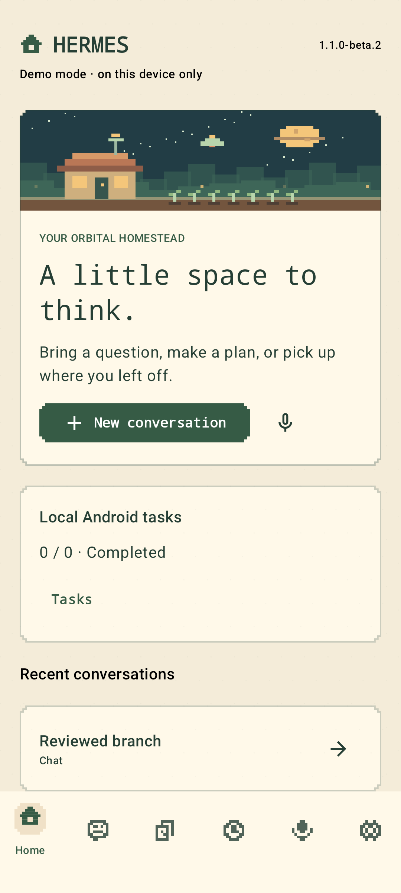
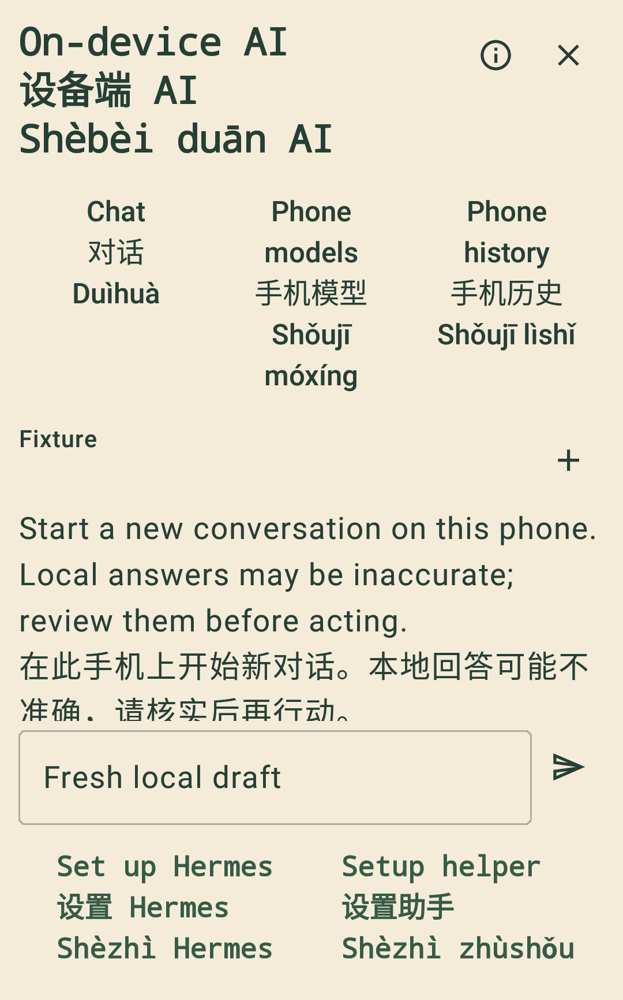

# Signal Grove

An unofficial, open-source Android companion for [Hermes Agent](https://github.com/NousResearch/hermes-agent), with a pixel-art interface and optional on-device text AI in the next release candidate. Hermes runs on your infrastructure; local phone conversations keep their own model and history.

**Android 8.0+ · Kotlin / Jetpack Compose · Five themes · English / 简体中文 / pinyin · MIT**

## Download and release status

| Version | Status | Install |
| --- | --- | --- |
| [1.0.0](https://github.com/DionCroft/Signal_Grove/releases/tag/v1.0.0) | Published stable community release | [Release assets](https://github.com/DionCroft/Signal_Grove/releases/tag/v1.0.0) |
| [1.1.0-beta.8](https://github.com/DionCroft/Signal_Grove/releases/tag/v1.1.0-beta.8) · code 111 | Published preview: serving-model selection, reasoning/service presets, existing chats and stored projects | [Download production APK](https://github.com/DionCroft/Signal_Grove/releases/download/v1.1.0-beta.8/hermes-agent-mobile-1.1.0-beta.8.apk) |
| [1.1.0-beta.9](docs/releases/1.1.0-beta.9.md) · code 112 | Unpublished candidate: optional offline AI, model management, setup helper and startup packaging improvements | Release checks remain; no public candidate APK yet |

The table below describes current `main`; release notes define what is included in each published APK. Production and debug are separate packages with separate signing keys. Upgrade the matching package to preserve its data; see [installation and migration](docs/USER_GUIDE.md). The [approved GitHub updater](docs/APP_UPDATES.md) requires your download/install approval, validates the APK and preserves active-work guards. Enable **Include preview releases** to discover betas.

[Brand and upgrade compatibility](docs/BRANDING.md) · [Changelog](CHANGELOG.md) · [Roadmap](ROADMAP.md) · [Full audit](docs/AUDIT_EXECUTION_PLAN.md)

Independent community project; not affiliated with or endorsed by NousResearch. Original pixel art and system fonts; no copied game assets.

## Features on main

| Area | What is implemented | Details |
| --- | --- | --- |
| Hermes chat and history | Capability-based Runs/session/compatibility transports; streaming, conversation search/paging, model choices, session locks/forks/steering, tool/subagent activity and reviewed approvals | [Protocol scope](docs/COMPATIBILITY.md) |
| Serving-model awareness | Distinguish the verified serving model, server default and conversation selection. Automatic follows the freshly verified serving model for new turns; reasoning/service use presets | [Model status/setup](docs/RUNTIME_MODEL_STATUS.md) |
| Optional on-device AI | Separate offline text chat/history, streamed cancellable generation, context/load/unload/delete controls, pinned LFM3 download and compatible GGUF import | [Usage and current limits](docs/ON_DEVICE_AI.md) |
| Setup and troubleshooting | Static setup guide works without a model; the optional helper selects versioned source-backed checks for setup, network, authentication, models, history and projects | [Set up Hermes](docs/SETUP_GUIDE.md) |
| Conversations and projects | Canonical read-only conversation viewer, hosted room browsing, stored project management and project-conversation navigation | [Feature and validation matrix](docs/FEATURES.md) |
| Host management | Reviewed provider/device-code accounts, credential pools, fallback chains, custom endpoints, MCPs, plugins, skills, channels and Kanban controls | [Management scopes](docs/MANAGEMENT.md) |
| Tasks and automation | Phone tasks with notes, filters, due dates/priorities and reviewed JSON transfer; opt-in supported Hermes scheduled-job controls | [User guide](docs/USER_GUIDE.md) |
| Voice and notifications | Foreground dictation/read-aloud through installed Android services; opt-in task/run monitoring and task-count widget | [Compatibility](docs/COMPATIBILITY.md) |
| Pixel interface | Starhaven Grove, Lavender Original, Jade Terminal, Solar Archive and Mint Circuit; stepped panels/icons, original animations, phone/tablet navigation, reduced motion and scalable text | [Themes](docs/THEMING.md) |
| Private connections and updates | Trusted HTTPS, profile path prefixes, Keystore-backed credential encryption, exact review of sensitive effects and signed, checksum-verified APK updates | [Security](SECURITY.md) |

A feature being implemented does not establish interoperability with every Hermes install. Controls depend on advertised server capabilities and authentication. Remote project metadata does not establish a worker's execution location. [Detailed implementation/validation boundaries](docs/FEATURES.md).

## Current figures

Checked **12 November 2026**. Counts describe their stated builds and test scopes; they are not combined into a single completion score.

| Check or measurement | Verified result | Scope |
| --- | ---: | --- |
| Candidate JVM tests | **1,006 cases / 96 reports** | Beta.9 candidate; no failures/errors/skips |
| Current HTTPS cancellation | **3 ms phone / 18-34 ms emulator** | Two initial cancellation observations per device; see the separate full foreground-resume result |
| Full foreground LFM3 resume | **27,010 ms** | One physical phone case: explicit resume, full 1,049,615,680-byte hash/metadata check and atomic install; not a speed guarantee |
| Candidate lint | **0 errors**; 51 debug / 50 release warnings | Both variants; warnings remain documented |
| Earlier candidate Android 8.0 UI | **10 / 10 passed** | Local-AI UI, consent/helper review and bilingual large text; synthetic state |
| Physical offline model tests | **6 / 6 passed** | Earlier original-key debug candidate on an ARM64 Android 17 phone; LFM3, Qwen and grounded helper |
| Prior complete standard device gate | **1,132 API26 / 1,133 API37 cases** | Independently verified source `7ee5c59`; fresh candidate full-suite acceptance remains pending |
| Physical model import observations | **649–1,438 ms** | Three observed LFM3/Qwen imports; not a speed guarantee |
| Highest observed process VmHWM in model tests | **2.43 GiB** | Short USB-charging phone tests; not a minimum-RAM requirement or sustained thermal/battery benchmark |
| Recommended LFM3 model file | **1.05 GB** | 1,049,615,680 bytes, separate licensed download; weights are not bundled |
| Signed candidate production APK | **71.0 MB** | 70,993,978 bytes; original signing identity, not published yet |
| Runtime advisory query | **150 Maven versions; 0 known matching advisories** | OSV query on 12 November; known-indexed coverage, not a full security certification |

[Full foreground phone download](docs/contracts/2026-11-12-foreground-model-download.md) · [Cancellation/build evidence](docs/contracts/2026-11-12-download-cancellation.md) · [Earlier packaging/UI evidence](docs/contracts/2026-11-12-uncompressed-dex-candidate.md) · [Physical offline evidence](docs/contracts/2026-11-12-physical-offline-model-acceptance.md) · [Prior standard gate](docs/contracts/2026-11-12-complete-standard-android-gate.md) · [Full validation history](docs/VALIDATION.md)

**Still open:** both HTTPS methods now have positive physical evidence, including full foreground resume; earlier emulator/frozen-phone failures are retained. Process/reboot, physical production-upgrade, full candidate CI (including failed API26 keyboard preparation), compatibility and publication checks remain. Current upstream inspection flags 40 changed used handlers on stable Hermes and 100 on the inspected `main`; these require review. The broader worker/project/automation/integration audit continues. Failed outcomes are retained in the evidence above.

## Interface figures

| Pixel interface | Candidate on-device AI |
| --- | --- |
|  |  |

Left: earlier Android 16 Demo capture. Right: exact beta.9 API26 component-test capture, synthetic model/draft, bilingual text at 130% font scale. These are app captures, not generated mockups or proof of live model output. [More themes, tablet views and capture provenance](docs/screenshots.md).

## Connect to Hermes

1. Run Hermes' authenticated API server on your existing host. Its normal local binding is `127.0.0.1:8642`.
2. Reach it through a private VPN such as Tailscale and trusted HTTPS. Keep the raw API port private.
3. In **Settings → Server**, enter the API root and bearer token, then **Save & test connection**. The app preserves profile prefixes such as `/p/work/`. Complete any Android local-network permission prompt when using a private endpoint.
4. Open Chat and Conversation history. Existing Desktop/Discord conversations can be read in their selected profile; API-owned conversations support replies and advertised controls. Use explicit paging for older chats.
5. Configure the separate **Hermes management** dashboard sign-in when using management/project features. Its authentication is separate from the chat API token.

`127.0.0.1` on Android means the phone. Production requires HTTPS. The token may grant powerful agent/tool access: keep it private. Start with labelled Demo mode to explore without a server.

[Complete setup guide](docs/SETUP_GUIDE.md) · [Connection details](docs/HERMES_CONNECTION.md) · [Official API reference](https://hermes-agent.nousresearch.com/docs/user-guide/features/api-server/)

## Use on-device AI

In the candidate, open **Chat → On-device AI** or **Settings → On-device AI**, review a model's licence, download/import it, choose a context and explicitly load it. Inference requires a 64-bit process and sufficient memory/storage. The metadata allowlist covers eight architecture names; actual compatibility is checked at load time. LFM3 and Qwen2.5-0.5B have physical native evidence; this does not certify arbitrary GGUF files.

Phone chat remains separate from Hermes. A new unsent text question can be reviewed into a fresh phone draft; remote history, credentials and approvals are excluded. Local advice can be reviewed for clipboard handoff. Failed or unknown remote work is never silently replayed locally or on reconnection. Leaving local AI cancels work and unloads weights. [Models, routing, helper and recovery details](docs/ON_DEVICE_AI.md).

## Build and contribute

JDK 24; Android SDK Platform 37 and CI Build Tools 36.0.0; NDK 29.0.14206865; CMake 3.31.6. Wrapper: Gradle 9.8.2; AGP 9.5.0; Compose plugin 2.4.21; KSP 2.3.13. Java bytecode target 17. Native sources are pinned by revision/hash.

```sh
./gradlew testDebugUnitTest lint assembleDebug assembleDebugAndroidTest
```

On Windows, use the verified snapshot wrapper and keep tools, caches, emulator data and temporary output on E:

```powershell
.\scripts\build-windows.ps1 -WorkRoot E:\Temp\hermes-mobile -AndroidSdk E:\Android\Sdk
```

Retain existing debug/production signing keys for upgrades. CI keys cannot update the owner's installed packages. Never commit signing material, credentials, model weights or generated/private evidence. [Development](docs/DEVELOPMENT.md) · [Release process](docs/RELEASING.md) · [Contributing](CONTRIBUTING.md) · [Notices](NOTICE.md).

## Important boundaries

- Read-aloud and dictation depend on installed Android services. On-device-only recognition is unavailable on the tested owner's phone; read-aloud was separately confirmed. This is independent of local LLM text inference.
- Run interruptions can leave unknown outcomes. Check the exact saved receipt/status; a response-ending event is not proof of completed tool work. Reconnection never silently replays an uncertain operation.
- Background checks are best effort, about every 15 minutes. They are not server push or exact reminder alarms. Widget task changes open the app.
- Chats, tasks, job cache and local models use app-private storage, not database encryption. Connection secrets use Keystore-backed encryption. Uninstall/app-data removal deletes private phone data; local models/history are excluded from Android backup.
- The full audit covers native authentication/recovery, worker identity/workspace access, automation/integrations, multi-connection/background/audio behavior and community-release hardening. [Compatibility](docs/COMPATIBILITY.md) and the [audit ledger](docs/AUDIT_EXECUTION_PLAN.md) retain the details.
