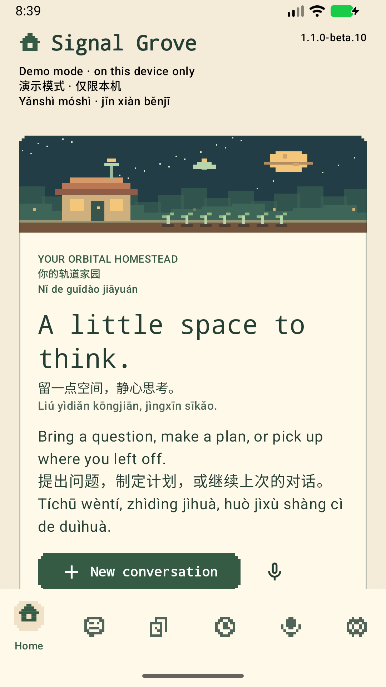

# Signal Grove

An unofficial, open-source Android companion for [Hermes Agent](https://github.com/NousResearch/hermes-agent), with a pixel-art interface and optional on-device text AI. Hermes runs on your infrastructure; local phone conversations keep their own model and history.

**[Download beta.10 APK](https://github.com/DionCroft/Signal_Grove/releases/download/v1.1.0-beta.10/hermes-agent-mobile-1.1.0-beta.10.apk)** · [GitHub prerelease](https://github.com/DionCroft/Signal_Grove/releases/tag/v1.1.0-beta.10) · [Active goal](docs/GOAL.md) · [Remaining audit](docs/AUDIT_EXECUTION_PLAN.md).

Beta.10 adds local chat editing and branching,
search and labels, Markdown and protected backups, reviewed summaries,
a two-model verified catalogue, document questions, writing presets,
personal profiles and temporary chats. It includes compact keyboard
layouts, a model-free setup checklist and the llama.cpp b12556 update.

The signed release passed **1,203 JVM tests** and zero-error lint. The independently verified hosted matrix executed **1,241 Android 8** and **1,242 Android 17** methods. Each API also passed 13 standard and seven compact checks locally.
The physical upgrade verified saved Hermes history and projects and
an offline LFM3 reply. An Android 8 upgrade path from the public
beta.9 APK retained a local task through the final signed candidate.
[Full hosted suite](https://github.com/DionCroft/Signal_Grove/actions/runs/44836131279).
[Offline AI guide](docs/ON_DEVICE_AI.md) ·
[Beta.10 release scope](docs/releases/1.1.0-beta.10.md) ·
[Validation evidence](docs/VALIDATION.md).

The earlier UI readiness and native keyboard checks on `a992cf4` passed **1,149 Android 8 / 1,150 Android 17** standard methods. The Hermes v0.23.2
watcher now produces a complete static review report. The reviewed Hermes
main revision remains incomplete with eight retired storage paths. Runtime
compatibility and owner shutdown remain open.
[Watcher and storage evidence](docs/contracts/2026-11-19-hermes-main-stored-history.md).

**Android 8.0+ · Kotlin / Jetpack Compose · Five themes · English / 简体中文 / pinyin · MIT**

## Development candidate

The unreleased candidate shows formatted prompt use and reply budget before
sending a phone request. It also shows context and compression reported by
the connected Hermes session, puts date presets directly in phone-history
search, and can preview registered workspace files from a followed chat
when the server advertises the authenticated read capability. The qualified
LFM3 phone window remains 4K.

The combined source passed **1,213 JVM tests** and zero-error lint.
Hosted worker checks passed **72 Windows provider** and **9 POSIX policy**
methods. The authenticated workspace fixture passed on Android 8 and 17.
The full Android matrix, live Pi verification and signed upgrade checks
remain part of release qualification. [Candidate evidence](docs/VALIDATION.md#integrated-audit-release-candidate).

The newer schedule-review build also previews upcoming occurrences with
UTC offsets and explains the missed-run policy before paused creation.
It passed **1,222 JVM tests** and the creation-review check at both
viewports on Android 8 and 17.
[Schedule preview evidence](docs/VALIDATION.md#calendar-and-missed-run-preview-in-the-schedule-review).

## Download and release status

| Version | Status | Install |
| --- | --- | --- |
| [1.0.0](https://github.com/DionCroft/Signal_Grove/releases/tag/v1.0.0) | Published stable community release | [Release assets](https://github.com/DionCroft/Signal_Grove/releases/tag/v1.0.0) |
| [1.1.0-beta.8](https://github.com/DionCroft/Signal_Grove/releases/tag/v1.1.0-beta.8) · code 111 | Published preview: serving-model selection, reasoning/service presets, existing chats and stored projects | [Download production APK](https://github.com/DionCroft/Signal_Grove/releases/download/v1.1.0-beta.8/hermes-agent-mobile-1.1.0-beta.8.apk) |
| [1.1.0-beta.9](docs/releases/1.1.0-beta.9.md) · code 114 | Published experimental preview: offline AI, model management, setup helper and packaging improvements; full acceptance remains open | [Download production APK](https://github.com/DionCroft/Signal_Grove/releases/download/v1.1.0-beta.9/hermes-agent-mobile-1.1.0-beta.9.apk) |
| [1.1.0-beta.10](https://github.com/DionCroft/Signal_Grove/releases/tag/v1.1.0-beta.10) · code 115 | Published preview with expanded offline AI and compact-screen fixes | [Download production APK](https://github.com/DionCroft/Signal_Grove/releases/download/v1.1.0-beta.10/hermes-agent-mobile-1.1.0-beta.10.apk) |

The table below describes current `main`; release notes define what is included in each published APK. Production and debug are separate packages with separate signing keys. Upgrade the matching package to preserve its data; see [installation and migration](docs/USER_GUIDE.md). The [approved GitHub updater](docs/APP_UPDATES.md) requires your download/install approval, validates the APK and preserves active-work guards. Enable **Include preview releases** to discover betas.

[Brand and upgrade compatibility](docs/BRANDING.md) · [Changelog](CHANGELOG.md) · [Roadmap](ROADMAP.md) · [Full audit](docs/AUDIT_EXECUTION_PLAN.md)

Independent community project; not affiliated with or endorsed by NousResearch. Original pixel art and system fonts; no copied game assets.

The [offline AI guide](docs/ON_DEVICE_AI.md) covers chat editing and branching, reviewed summaries, searchable history and protected backups. The [offline backlog](docs/ON_DEVICE_AI_BACKLOG.md) tracks the later improvements.

## Features on main

| Area | What is implemented | Details |
| --- | --- | --- |
| Hermes chat and history | Capability-based Runs/session/compatibility transports; streaming, conversation search/paging, model choices, session locks/forks/steering, tool/subagent activity and reviewed approvals | [Protocol scope](docs/COMPATIBILITY.md) |
| Serving-model awareness | Distinguish the verified serving model, server default and conversation selection. Automatic follows the freshly verified serving model for new turns; reasoning/service use presets | [Model status/setup](docs/RUNTIME_MODEL_STATUS.md) |
| Optional on-device AI | Separate offline text chat/history, streamed cancellable generation, context/load/unload/delete controls, pinned LFM3 and Qwen downloads, compatible GGUF import, local history search and backups, personal context and temporary chat | [Usage and current limits](docs/ON_DEVICE_AI.md) |
| Setup and troubleshooting | Static setup guide works without a model; the optional helper selects versioned source-backed checks for setup, network, authentication, models, history and projects | [Set up Hermes](docs/SETUP_GUIDE.md) |
| Conversations and projects | Canonical read-only conversation viewer, hosted room browsing, stored project management and project-conversation navigation | [Feature and validation matrix](docs/FEATURES.md) |
| Host management | Reviewed provider/device-code accounts, credential pools, fallback chains, custom endpoints, MCPs, plugins, skills, channels and Kanban controls | [Management scopes](docs/MANAGEMENT.md) |
| Tasks and automation | Phone tasks with notes, filters, due dates/priorities and reviewed JSON transfer; opt-in supported Hermes scheduled-job controls | [User guide](docs/USER_GUIDE.md) |
| Voice and notifications | Foreground dictation/read-aloud through installed Android services; opt-in task/run monitoring and task-count widget | [Compatibility](docs/COMPATIBILITY.md) |
| Pixel interface | Starhaven Grove, Lavender Original, Jade Terminal, Solar Archive and Mint Circuit; stepped panels/icons, original animations, phone/tablet navigation, reduced motion and scalable text | [Themes](docs/THEMING.md) |
| Private connections and updates | Trusted HTTPS, profile path prefixes, Keystore-backed credential encryption, exact review of sensitive effects and signed, checksum-verified APK updates | [Security](SECURITY.md) |

A feature being implemented does not establish interoperability with every Hermes install. Controls depend on advertised server capabilities and authentication. Remote project metadata does not establish a worker's execution location. [Detailed implementation/validation boundaries](docs/FEATURES.md).

## Current figures

Updated **21 November 2026** for the published beta.10 build. Earlier figures retain their original build and test scope.

| Check or measurement | Verified result | Scope |
| --- | ---: | --- |
| Published beta.10 production APK, code 115 | **76.1 MB** | 76,066,678 bytes, original signer and anonymous download verified. [Release files](https://github.com/DionCroft/Signal_Grove/releases/tag/v1.1.0-beta.10) |
| Beta.10 local JVM | **1,203 tests across 113 reports** | No failures, errors or skips. |
| Beta.10 signed-source lint | **0 errors**, 55 debug and 54 release warnings | Both actual lint reports for source d651a33 |
| Beta.10 hosted standard device gate | **1,241 Android 8 / 1,242 Android 17** | Four raw partitions checked against the hosted aggregate. Physical inference was tested separately. [Exact evidence](docs/VALIDATION.md#published-beta10-release-verification) |
| Beta.10 hosted policy | **1,179 tests** | Passed on the exact published source. |
| Beta.10 advisory query | **154 Maven coordinates and one native source revision** | OSV returned zero matching advisories on 20 November. This is a snapshot of indexed advisories. |
| Merged UI standard device cohort | **1,149 API26 / 1,150 API37 methods** | Identical reviewed-head/PR/main trees; independent raw four-shard union, no skips; external models remain separate |
| Earlier offline chat and phone backups | **1,146 JVM / 72 focused Android methods per API (26 and 37)** | Reviewed Markdown, plain and protected backup, and collision-aware restore. Physical Markdown save and offline restore passed. Final release gates remain. [Exact checks](docs/contracts/2026-11-19-phone-history-backup-ui.md) |
| Earlier phone context meter | **1,148 JVM / 73 focused Android methods per API (26 and 37)** | Pinned LFM3 measured 489 prompt and 23 output tokens at the 512-token boundary on the Android 17 emulator. [Context checks](docs/contracts/2026-11-19-phone-context-meter.md) |
| Hosted context and fixture checkpoint | **1,203 API 26 / 1,204 API 37 standard methods** | Verified four raw shards and matching APKs on commit 3d2b24a. [Hosted run](https://github.com/DionCroft/Signal_Grove/actions/runs/44560196101) |
| Earlier selected-turn continuation | **1,150 JVM / 76 focused Android methods per API (26 and 37)** | Reviewed copying and backup restore preserve source chat bytes, draft and selected-turn provenance. [Exact checks](docs/contracts/2026-11-19-phone-selected-turns.md) |
| Earlier reviewed phone summaries | **1,152 JVM / 81 focused Android methods per API (26 and 37)** | Users can edit a local draft, start a separate chat from approved context, then search, export or back it up. [Exact checks](docs/contracts/2026-11-19-phone-reviewed-summaries.md) |
| Earlier phone performance presets | **1,155 JVM / 82 focused Android methods per API (26 and 37)** | Saved by model fingerprint. Presets and advanced context, thread, and reply caps apply at the next explicit load. [Exact checks](docs/contracts/2026-11-19-phone-model-performance.md) |
| Earlier phone model catalogue | **1,158 JVM / 85 focused Android methods per API (26 and 37)** | Two pinned publisher files, offline comparison and per-model partials. [Exact checks](docs/VALIDATION.md#offline-catalogue-and-separate-model-downloads) |
| Earlier installed model library | **1,158 JVM / 87 focused Android methods per API (26 and 37)** | Search by name, architecture or SHA-256, show storage, and keep licence consent within reach. [Exact checks](docs/VALIDATION.md#installed-model-library-and-fixed-licence-controls) |
| Current physical branching checkpoint | **One offline native method; three separate real UI actions** | Explicit app pairings; native branches plus actual UI branches/search/Clear/read; all four real UI histories unchanged, no whole-feature acceptance |
| Maintained SDK unbound-status component | **16 read-only checks / two real turn receipts** | Corrected declared SDK copy; includes five expected UNKNOWN outcomes and idle second profile; not gateway/fleet/PM acceptance |
| Prior original-SDK gateway lifecycle | **Freeze/drain/native stop verified in its configured home** | Source `6e1325b` fixture, original SDK/dependency baseline and profiler scope; corrected SDK gateway-wire/fleet acceptance remains open |
| New fixture boundary methods | **10 / 10 on Pi and Windows** | Negative scope/epoch/admission/read-only command guards; overlaps full policy counts |
| Earlier offline checklist and setup helper | **1,198 JVM / 153 focused Android methods per API (26 and 37)** | Model, storage and history state; reviewed topic search with the model unloaded and networking off. [Exact checks](docs/VALIDATION.md#offline-checklist-and-setup-issue-search) |
| Earlier optional On-device AI startup | **1,158 JVM / 94 focused Android methods per API (26 and 37)** | Saved app-icon routing, explicit Hermes return, and widget, notification and share coverage. [Exact checks](docs/VALIDATION.md#optional-on-device-ai-startup) |
| Earlier reviewed model downloads | **1,162 JVM / 96 focused Android methods per API (26 and 37)** | Durable queue, explicit start, pause and resume, and exact saved bytes. [Exact checks](docs/VALIDATION.md#reviewed-download-queue-and-explicit-resume) |
| Earlier model download network preference | **1,165 JVM / 99 focused Android methods per API (26 and 37)** | Optional unmetered downloads, explicit resume after a network change and offline verification. [Exact checks](docs/VALIDATION.md#model-download-network-preference) |
| Earlier temporary phone chat | **1,186 JVM / 109 of 110 on API 26 / 110 of 110 on API 37** | Foreground-only local chat, context and exit checks, and a real two-turn offline LFM3 run. [Exact checks](docs/VALIDATION.md#foreground-only-temporary-phone-chats) |
| Earlier offline writing tools | **1,183 JVM / 108 focused Android methods per API (26 and 37)** | Editable presets, custom templates and reviewed Android text sharing with a local model and result notes. [Exact checks](docs/VALIDATION.md#reviewed-offline-writing-tools) |
| Earlier offline document questions | **1,179 JVM / 106 focused Android methods per API (26 and 37)** | Review and cite excerpts from TXT and Markdown, plus original pages from text PDFs on Android 15 and newer. Android 17 verified an offline LFM3 page citation. [Exact checks](docs/VALIDATION.md#offline-questions-about-pdf-pages) |
| Earlier publisher model update review | **1,173 JVM / 103 focused Android methods per API (26 and 37)** | Review an incoming pinned revision and storage while retaining original queue entries and chat bindings. [Exact checks](docs/VALIDATION.md#publisher-catalogue-revision-updates) |
| Earlier GGUF replacement review | **1,170 JVM / 102 focused Android methods per API (26 and 37)** | Review a local model file, install alongside and keep previous chats bound. [Exact checks](docs/VALIDATION.md#reviewed-replacement-from-a-phone-model-file) |
| Earlier opt-in background model downloads | **1,167 JVM / 100 focused Android methods per API (26 and 37)** | One reviewed transfer with visible progress and item-scoped Pause. [Exact checks](docs/VALIDATION.md#opt-in-model-downloads-while-away-from-the-app) |
| Hosted catalogue device matrix | **1,212 API 26 / 1,213 API 37 standard methods** | Four verified shards and published aggregate for catalogue commit 6bc7ff0. [Hosted run](https://github.com/DionCroft/Signal_Grove/actions/runs/44625566131) |
| Current Windows policy suite | **885 passes / 273 platform skips** | 1,158 distinct cases in this chunk; new native component observations are separate |
| Previous controlled Pi cohort | **104 methods / no skips** | Eight native gateway cases plus existing PM/backup/retirement coverage; four-mode SDK trial separately verifies eight requests |
| Last independently reviewed hosted policy suite | **1,161 methods / no skips** | Exact catalogue commit 6bc7ff0. [Hosted evidence](docs/VALIDATION.md#hosted-demo-and-keyboard-regression-recheck) |
| Merged UI local JVM baseline | **1,011 cases / 97 reports** | UI snapshot 1f46186; actual XML, no failures/errors/skips; previous hosted scopes retained separately |
| Focused workspace/native-tap device checks | **27 methods on each API / no skips** | API26 + API37, same verified APKs; actual late-keyboard transition and single native input, not full device acceptance |
| Current HTTPS cancellation | **3 ms phone / 18-34 ms emulator** | Two initial cancellation observations per device; see the separate full foreground-resume result |
| Full foreground LFM3 resume | **27,010 ms** | One physical phone case: explicit resume, full 1,049,615,680-byte hash/metadata check and atomic install; not a speed guarantee |
| Physical process/restart recovery | **2 positive cases; 2.849 / 1.856 s JUnit** | Original cold/post-reboot methods on the owner phone; one approved normal restart, no automatic load/replay, original data retained; preparation intentionally interrupted |
| Stable native-auth/startup fixture | **87 / 87 cases** | Exact stable3b42157; real ASGI, loader helpers and start-entry/PM suppression with explicit adapters; not full backend, live Pi or complete socket acceptance |
| Current stable canonical authority | **46 authority/wire +13 attach-first cases** | Separate real-source flows with synthetic actors/transports; strict schemas and replay/no-replay guards, not full socket/live acceptance |
| Unmodified native owner room reads | **20 checks** | Real Windows owner tickets/sockets, synthetic room data; original empty mode retained; both report the open shutdown finding |
| Portable compatibility and Windows workspace checks | **513 portable / 15 runtime-model / 72 Windows native cases** | Pinned client correction is live; five normal Pi reads and same daemon/receipts verified; native app-auth/phone/NAS acceptance remains open |
| Repository HTTP coordinator binding | **16 transport / 18 native authority cases** | Owner-approved source fix; actual PKCE/tickets/TCP with synthetic worker; Pi/native Android deployment acceptance and SDK shutdown remain open |
| Actual staged Pi owner transport | **16 coordinator outcomes / 50 protocol assertions** | Native UID + synthetic-IdP HTTP PKCE/refresh/tickets/WS and exact workspace receipts; zero fence refusals, lifecycle warning holds the overall gate; no live activation |
| Exact upstream plugin install | **17 canonical cases / 4 files** | Pristine v0.23.1; reviewed source moves/commit/catalog/exists refusals. Separate full RPC file now has six canonical Linux positives, including POSIX host; exact source/artifact verified |
| Optional protected operator binding | **8 portable / 8 Linux native policy cases** | Explicit grants, fixed routes and fresh file-generation checks. Exact-source Linux/Windows artifacts verified; no Pi deployment |
| Backup archive content component | **26 Pi methods; earlier SDK/age fixture** | Exact members/hash/CRC and SQLite integrity; Windows creation-time fix plus 250 fresh images. Earlier fixture verifies two WAL rows and crypto round-trip; full transaction remains open |
| Private backup publication component | **32 Pi methods** | Actual journal/manager/path boundary with loopback GitHub protocol and prior SDK/age ciphertext; once-only effects and downloaded bytes verified, real private GitHub acceptance remains open |
| Earlier backup-stage implementation | **97 Pi cohort methods + one actual SDK/age stage** | Generated state/disposable key, two WAL rows and loopback private publication; independently reconstructed specification and crypto/SQL readback. Real private GitHub/live-home/external-provider acceptance remains open |
| Shared operational directory boundary | **208 Pi methods + one actual guarded install** | Ten roles, guarded journal and PM, shared actual mode/parent witnesses; independent raw/native review. Component cohorts overlap; canonical provisioning and full transaction remain open |
| Native PM preparation component | **48 Pi cases + one actual install** | Separate fresh private home, supported full install/currency, four activation inputs and ARM64 imports; independently verified. Includes 25 overlapping service cases; canonical provisioning and full cutover remain open |
| Current Pi source preservation | **79 live paths unchanged / 18 native authority outcomes** | Isolated ARM64 PM candidate built with only vendor-path rebase; same cases pass on Windows/Pi. Live activation and both permission prerequisites remain open; [exact scope](docs/contracts/2026-11-14-native-arm64-staged-candidate.md) |
| Official shutdown regression cohorts | **50 cases each: pristine and candidate** | Exact stable3b plus the reviewed two-file candidate; six canonical no-retry file runs, identical cases, immutable sources; original owner-runtime warning stays open |
| Experimental heartbeat candidate | **8 helper cases; 3 explicit native owner trials** | Exact 3b42157 + two-file patch, default-off reproducible mode; 1.219 s held-writer close fence; not deployed or accepted as unmodified upstream |
| Earlier candidate Android 8.0 UI | **10 / 10 passed** | Local-AI UI, consent/helper review and bilingual large text; synthetic state |
| Physical offline model tests | **6 / 6 passed** | Earlier original-key debug candidate on an ARM64 Android 17 phone; LFM3, Qwen and grounded helper |
| Current selected offline methods | **7 have positive evidence** | Unchanged code114 source0ee app, separately identified companions; garden/metadata/helper/generation/Qwen/switch/import; not the full external-model gate; old failures retained |
| Current workspace Review regression | **31 / 31 API26 cases** | Native UI, rendered-outline counterexamples and six scripted dispatch guards;16 acknowledged native taps, not full-suite/live acceptance |
| Physical LFM3 1.7B benchmark · development build | **3.06 s** to first visible text · **44.3 sampled tokens/s** | One offline run on M098FE, 127 sampled tokens and 2,370.47 MiB after-load process PSS. Sustained speed and battery drain remain unmeasured. [Benchmark evidence](docs/VALIDATION.md#physical-lfm3-benchmark-with-networking-off) |
| Physical model import observations | **649–1,438 ms** | Three observed LFM3/Qwen imports; not a speed guarantee |
| Highest observed process VmHWM in model tests | **2.43 GiB** | Short USB-charging phone tests; not a minimum-RAM requirement or sustained thermal/battery benchmark |
| Recommended LFM3 model file | **1.05 GB** | 1,049,615,680 bytes, separate licensed download; weights are not bundled |

[Fresh reviewed-main signed candidate](docs/contracts/2026-11-12-reviewed-main-beta9-candidate.md) · [Native owner rooms and complete Android freeze](docs/contracts/2026-11-12-native-owner-room-reads.md) · [Current-stable canonical authority](docs/contracts/2026-11-12-current-stable-authority.md) · [Real loader/start-entry and complete hosted gate](docs/contracts/2026-11-12-native-loader-startup.md) · [Native workspace Review and preserved CI failure](docs/contracts/2026-11-12-native-workspace-review.md) · [Current stable auth/clean release inventory](docs/contracts/2026-11-12-current-stable-auth-release-inventory.md) · [Physical restart retention](docs/contracts/2026-11-12-physical-restart-retention.md) · [Both keyboard states](docs/contracts/2026-11-12-ready-keyboard.md) · [Earlier emulator cold recovery](docs/contracts/2026-11-12-native-cold-recovery.md) · [Full foreground phone download](docs/contracts/2026-11-12-foreground-model-download.md) · [Cancellation/build evidence](docs/contracts/2026-11-12-download-cancellation.md) · [Earlier packaging/UI evidence](docs/contracts/2026-11-12-uncompressed-dex-candidate.md) · [Physical offline evidence](docs/contracts/2026-11-12-physical-offline-model-acceptance.md) · [Prior standard gate](docs/contracts/2026-11-12-complete-standard-android-gate.md) · [Full validation history](docs/VALIDATION.md)

The [unique Chat-route evidence](docs/contracts/2026-11-13-unique-chat-route.md)
records a hosted transition failure where messages loaded while Home remained
selected. Tests now use the unique route target, click once and require Chat
selection. Fresh 16-method scopes pass independently on API26/37, including
duplicate-target/no-replay counterexamples and actual keyboard transitions.
Required checks pass 1,011 JVM cases and zero-error lint; full final-source
coverage and original API26 causes remain open. The
[earlier keyboard/upstream review](docs/contracts/2026-11-13-keyboard-gap-and-upstream-delta.md)
retains its native gap and semantic/transitive compatibility limits.

The [pipe availability investigation](docs/contracts/2026-11-13-pipe-availability.md)
retains earlier failures and the measured local busy-pipe race. The
[live read-client correction](docs/contracts/2026-11-13-live-read-client-update.md)
now passes normal installed-helper Pi reads against the same daemon, with fresh
encrypted component recovery and original receipts. Native app-auth and Android
workspace/file/NAS acceptance remain open.

The [transitive/shutdown review](docs/contracts/2026-11-13-transitive-review-and-shutdown.md)
adds source-context guards without resetting the baseline, records paired
50-case official regression cohorts and verifies the new API26 raw union.
The separate shutdown warning and final-current-head gate stay open; the complete
c814 fixture gate is reconciled below.

The [complete wrapper review](docs/contracts/2026-11-13-existing-host-client-integration.md)
records the pre-installation source/native/Pi proof and recovery plan. The
[live commissioning](docs/contracts/2026-11-13-live-read-client-update.md) records
the subsequent atomic client update without a daemon restart. The
[fresh readiness investigation](docs/contracts/2026-11-13-fresh-workspace-readiness.md)
preserves the measured refusal before native admission and c814 gate evidence.
Doctor and graph findings, native app login, phone/NAS and the wider audit remain.

The [HTTP operator binding review](docs/contracts/2026-11-13-http-operator-binding-review.md)
records the real valid-login refusal, tested unapplied proposal, retained SDK
shutdown warning and complete source 4444 Android raw/APK reconciliation.

**Still open:** wider upstream Hermes compatibility and shutdown cleanup, real workspace and worker acceptance, automation and integration acceptance, and the remaining device and community checks.
Every remaining requirement stays in the [full audit](docs/AUDIT_EXECUTION_PLAN.md).

## Interface figures

| Demo home | On-device model catalogue |
| --- | --- |
|  |  |

Captured from the signed beta.10 candidate on an Android 17 emulator in Demo
mode. The catalogue shows the requirements for the listed LFM3 model.
[More themes, tablet views and capture details](docs/screenshots.md).

## Connect to Hermes

1. Run Hermes' authenticated API server on your existing host. Its normal local binding is `127.0.0.1:8642`.
2. Reach it through a private VPN such as Tailscale and trusted HTTPS. Keep the raw API port private.
3. In **Settings → Server**, enter the API root and bearer token, then **Save & test connection**. The app preserves profile prefixes such as `/p/work/`. Complete any Android local-network permission prompt when using a private endpoint.
4. Open Chat and Conversation history. Existing Desktop/Discord conversations can be read in their selected profile; API-owned conversations support replies and advertised controls. Use explicit paging for older chats.
5. Configure the separate **Hermes management** dashboard sign-in when using management/project features. Its authentication is separate from the chat API token.

`127.0.0.1` on Android means the phone. Production requires HTTPS. The token may grant powerful agent/tool access: keep it private. Start with labelled Demo mode to explore without a server.

[Complete setup guide](docs/SETUP_GUIDE.md) · [Connection details](docs/HERMES_CONNECTION.md) · [Official API reference](https://hermes-agent.nousresearch.com/docs/user-guide/features/api-server/)

## Use on-device AI

The development branch adds **Phone models → Compare downloadable models**.
Compare LFM3 and the smaller Qwen2.5-0.5B model offline, then review
the exact publisher file and its licence before downloading.
[Catalogue, memory requirements and validation](docs/ON_DEVICE_AI.md#compare-downloadable-models-in-the-development-build).

In beta.10, open **Chat → On-device AI** or **Settings → On-device AI**, review a model's licence, download/import it, choose a context and explicitly load it. Inference requires a 64-bit process and sufficient memory/storage. The metadata allowlist covers eight architecture names; actual compatibility is checked at load time. LFM3 and Qwen2.5-0.5B have physical native evidence; this does not certify arbitrary GGUF files.

Phone chat remains separate from Hermes. A new unsent text question can be reviewed into a fresh phone draft; remote history, credentials and approvals are excluded. Local advice can be reviewed for clipboard handoff. Failed or unknown remote work is never silently replayed locally or on reconnection. Leaving local AI cancels work and unloads weights. [Models, routing, helper and recovery details](docs/ON_DEVICE_AI.md).

## Build and contribute

JDK 24; Android SDK Platform 37 and CI Build Tools 36.0.0; NDK 29.0.14206865; CMake 3.31.6. Wrapper: Gradle 9.8.2; AGP 9.5.0; Compose plugin 2.4.21; KSP 2.3.13. Java bytecode target 17. Native sources are pinned by revision/hash.

```sh
./gradlew testDebugUnitTest lint assembleDebug assembleDebugAndroidTest
```

On Windows, use the verified snapshot wrapper and keep tools, caches, emulator data and temporary output on E:

```powershell
.\scripts\build-windows.ps1 -WorkRoot E:\Temp\hermes-mobile -AndroidSdk E:\Android\Sdk
```

Retain existing debug/production signing keys for upgrades. CI keys cannot update the owner's installed packages. Never commit signing material, credentials, model weights or generated/private evidence. [Development](docs/DEVELOPMENT.md) · [Release process](docs/RELEASING.md) · [Contributing](CONTRIBUTING.md) · [Notices](NOTICE.md).

## Important boundaries

- Read-aloud and dictation depend on installed Android services. On-device-only recognition is unavailable on the tested owner's phone; read-aloud was separately confirmed. This is independent of local LLM text inference.
- Run interruptions can leave unknown outcomes. Check the exact saved receipt/status; a response-ending event is not proof of completed tool work. Reconnection never silently replays an uncertain operation.
- Background checks are best effort, about every 15 minutes. They are not server push or exact reminder alarms. Widget task changes open the app.
- Chats, tasks, job cache and local models use app-private storage, not database encryption. Connection secrets use Keystore-backed encryption. Uninstall/app-data removal deletes private phone data; local models/history are excluded from Android backup.
- The full audit covers native authentication/recovery, worker identity/workspace access, automation/integrations, multi-connection/background/audio behavior and community-release hardening. [Compatibility](docs/COMPATIBILITY.md) and the [audit ledger](docs/AUDIT_EXECUTION_PLAN.md) retain the details.

Latest source acceptance: [pristine canonical Linux RPC, current Android cohort and native Pi staging](docs/contracts/2026-11-14-canonical-linux-and-device-gates.md). These do not close the separate shutdown, live integration or final signed-phone gates.

[Actual staged Pi transport result and held lifecycle gate](docs/contracts/2026-11-14-actual-pi-owner-http.md).

[Guarded whole-snapshot lifecycle preparer](docs/contracts/2026-11-14-snapshot-heartbeat-preparer.md): exact maintained source/mode preservation is verified; native runtime gates remain separate.

[Actual Pi lifecycle candidate](docs/contracts/2026-11-14-maintained-heartbeat-native.md): eight helpers and normal/held owner exits pass; canonical Linux/final app-environment and live activation gates remain.
