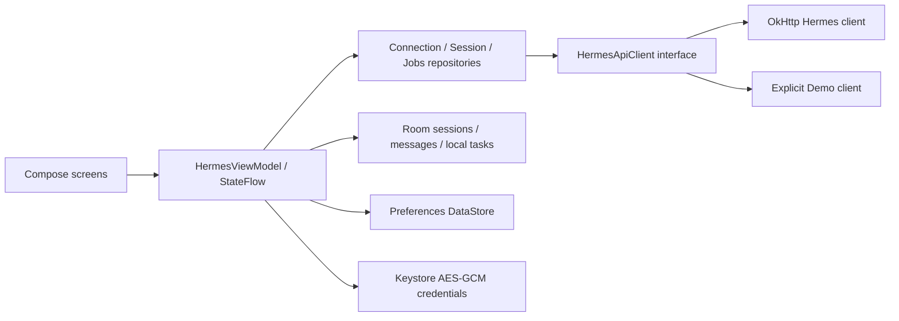

# Architecture

Single application module; package boundaries separate data, networking and Compose UI without unnecessary dependency injection infrastructure.

`HermesApplication` owns the Room database, preferences and credential store. `HermesViewModel` survives configuration changes and orchestrates cancellable foreground work, durable turn receipts and UI state. Compose collects flows with lifecycle awareness. Voice recogniser lifetime is scoped to its screen and observes app backgrounding.

`HermesConnectionRepository` validates/test-discovers the server; settings become active only after a successful request. `HermesSessionRepository` imports API-owned sessions and initially loads history. `HermesJobsRepository` performs read-only list/detail calls. Local task operations use the DAO.

Server conversation partitions are SHA-256 hashes of the normalized root URL plus credential, so switching credentials or profiles never loads another partition. The hash is an isolation identifier, not a stored token. Demo uses its own partition. Conversations persist remote IDs, request IDs, input, transport and run state. Messages preserve original content and timestamps. Room v1 schema is exported and checked in. There are no destructive migration fallbacks.

Transport selection: create an API session if advertised; prefer Runs for native session continuity plus replayable admission and visible control; otherwise native session SSE; otherwise compatibility completions with full local history. Non-Runs streams are never silently resubmitted. Runs retry uses the exact stored key/body within 23 hours (server documents 24-hour retention). A known run ID always takes the read-only status path. Expired/missing status does not authorize a new execution.

SSE framing is incremental, accepts comments and multiline data, and bounds event size. Okio handles split UTF-8 bytes. Typed updates separate text deltas, assistant final text, tool activity, approval requests and actual terminal status. A bounded HTTP body reader avoids unbounded JSON responses. Redirects and automatic transport retries are disabled. Error bodies are not displayed or logged.

An assistant-finalisation event can replace accumulated display text but cannot complete the run. Run completed/failed/cancelled/interrupted events decide terminal state. Compatibility finish reasons label response completion only. Stream EOF without an authoritative terminal event is unknown and supports explicit reconciliation. Accepted stop requests are reconciled instead of assuming cancellation. Pending receipts are retained across process death; the alpha does not automatically restart/reattach them.
