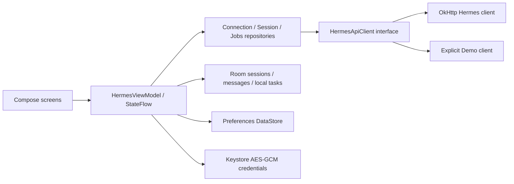

# Architecture

Single application module; package boundaries separate data, networking and Compose UI without unnecessary dependency injection infrastructure.

`HermesApplication` owns the Room database, preferences and credential store. `HermesViewModel` survives configuration changes and orchestrates cancellable foreground work, durable turn receipts and UI state. Compose collects flows with lifecycle awareness. Voice recogniser lifetime is scoped to its screen and observes app backgrounding.

`HermesConnectionRepository` validates/test-discovers the server; settings become active only after a successful request. `HermesSessionRepository` imports paginated API-owned session metadata and atomically refreshes settled history. A transaction rechecks run state before replacing message rows, protecting a send that started during the network request. `HermesJobsRepository` performs read-only list/detail calls and retains partitioned Room snapshots on errors. Local task operations use the DAO, with pure calendar-aware search/filter logic.

Server conversation partitions are SHA-256 hashes of the normalized root URL plus credential, so switching credentials or profiles never loads another partition. The hash is an isolation identifier, not a stored token. Demo uses its own partition. Conversations persist remote IDs, request IDs, input, transport and run state. Messages preserve original content and timestamps. Room schemas 1 through 4 are exported and checked in. The explicit 1→2 migration adds task notes, local session flags and the job cache. An instrumented test creates the old database from its actual exported schema and verifies data/receipt preservation. There are no destructive migration fallbacks.

Transport selection: create an API session if advertised; prefer Runs for native session continuity plus replayable admission and visible control; otherwise native session SSE; otherwise compatibility completions with full local history. Non-Runs streams are never silently resubmitted. Runs retry uses the exact stored key/body within 23 hours (server documents 24-hour retention). A known run ID always takes the read-only status path. Expired/missing status does not authorize a new execution.

SSE framing is incremental, accepts comments and multiline data, and bounds event size. Okio handles split UTF-8 bytes. Typed updates separate text deltas, assistant final text, tool activity, approval requests and actual terminal status. A bounded HTTP body reader avoids unbounded JSON responses. Redirects and automatic transport retries are disabled. Error bodies are not displayed or logged.

An assistant-finalisation event can replace accumulated display text but cannot complete the run. Run completed/failed/cancelled/interrupted events decide terminal state. Compatibility finish reasons label response completion only. Stream EOF without an authoritative terminal event is unknown and supports explicit reconciliation. Accepted stop requests are reconciled instead of assuming cancellation. Pending receipts are retained across process death; the app waits for explicit Check / recover before reconciling or resuming them.

## Durable interactions in 0.3

Schema 3 adds tool events, pending controls and sequence/admission/generation receipts. Each SSE update persists cursor, message, tool and control changes in one transaction. Resume GETs include Last-Event-ID; repeated sequences are ignored. Replay truncation marks a sentinel that disables further stream append and retains read-only status recovery.

InteractionRepository compares the full displayed request to current local state, refreshes the server snapshot, and verifies identity, generation, kind and prompt before mutation. Responding rows survive process death as unknown; resolved tombstones resist stale snapshots. No response is retried automatically. A tool failure never decides the run outcome.

SpeechRecognizer and TextToSpeech are foreground screen resources. Recognition defaults to a local recognizer or a visible unavailable state. TTS requires an explicit tap, filters network voices unless opted in, splits at safe UTF-16 boundaries, and stops/disposes with lifecycle. Audio is not sent to the Hermes client.

## Background and automation in 0.4

The credential vault stores one AES-GCM payload containing URL, token and debug policy. SharedPreferences commit atomically replaces it. Foreground migration pairs the old token with the old preferences once; workers read only the complete vault. Each network check uses a fixed pair, rechecks active preferences/vault before notification, and never submits runs or decisions.

WorkManager schedules opt-in 15-minute best-effort checks. Local due dates use the local calendar. Database insert-ignore receipts claim notification identities before posting, preferring a missed notice over duplicate delivery after a crash. Force-stop/battery/network restrictions can delay or suppress checks. The widget uses RemoteViews with aggregate local counts, immutable explicit PendingIntents, a refresh action and Tasks navigation; no secret or task text leaves the app.

JobOperationsRepository persists sending/unknown/confirmed/reviewed outcomes in schema 4. All mutation requests are one-shot. A lost acknowledgement blocks subsequent changes in that profile until human review. UI locks profile switching during mutation. Confirmed action and list refresh are separate, so refresh failure cannot replay a mutation. The editor sends only name/prompt and an explicitly replaced schedule; create also requests paused local delivery.

## Stable task migration boundary

TaskTransfer defines a versioned JSON format containing local tasks only. A bounded UTF-8 decoder rejects oversized, malformed, deeply nested, duplicate-ID or invalid-field inputs before any mutation. The UI uses Android's Storage Access Framework, previews the count and requires explicit confirmation. Room merges matching IDs inside one transaction, preserving unlisted tasks. Export reads the DAO snapshot rather than a potentially not-yet-loaded UI flow. This enables migration between the separate debug/production app IDs without exposing credentials or sharing private databases.
