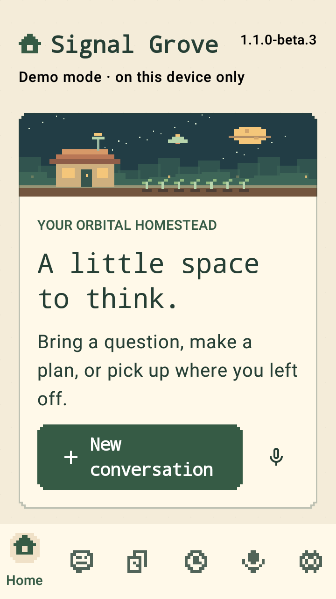
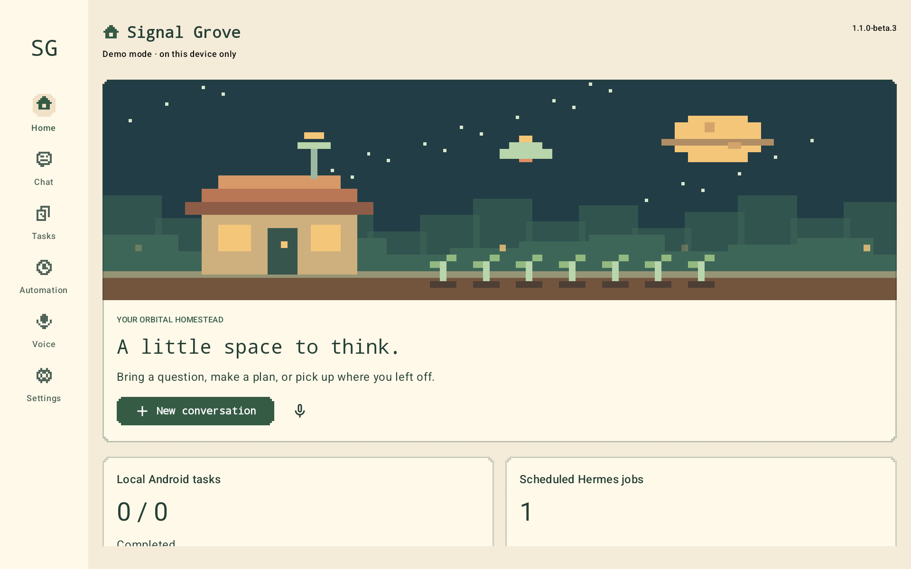
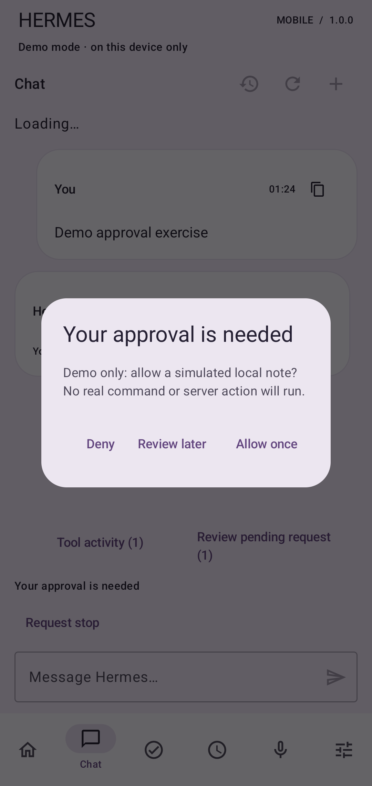
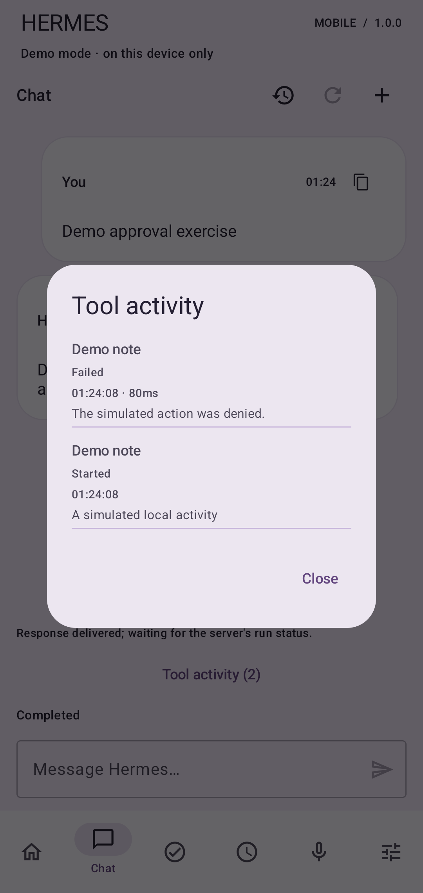
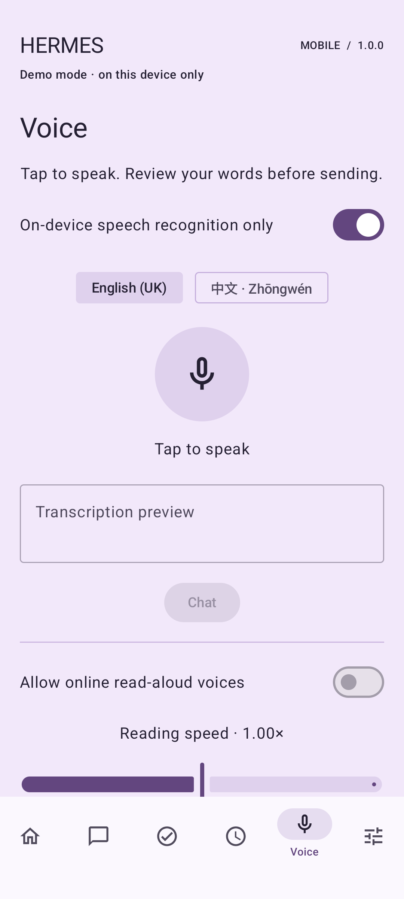
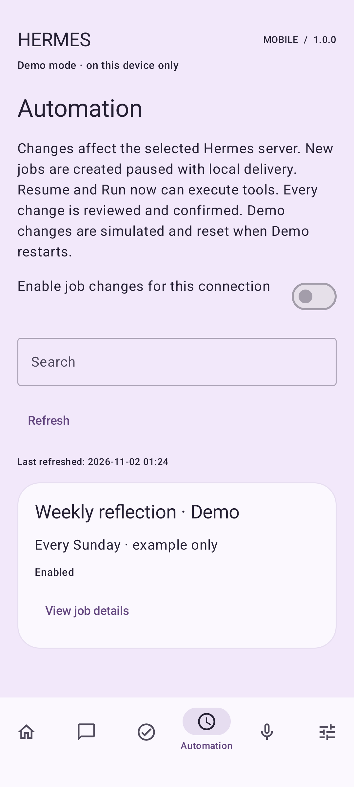
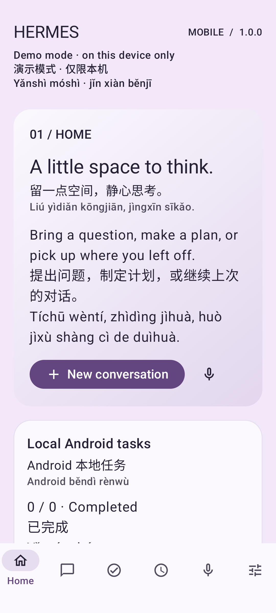
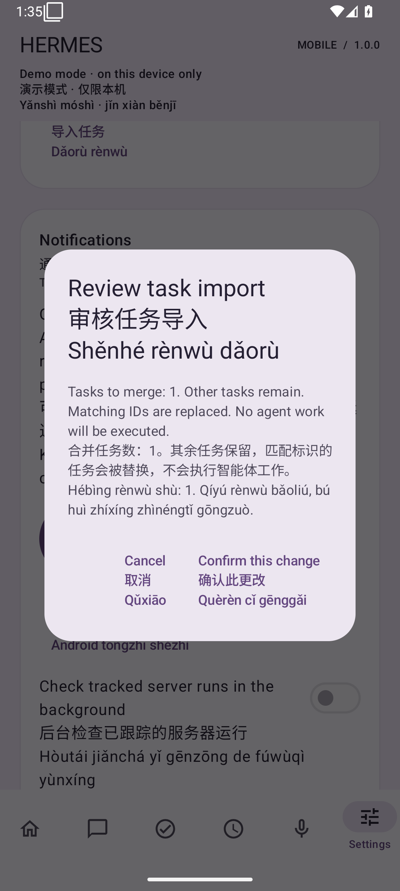
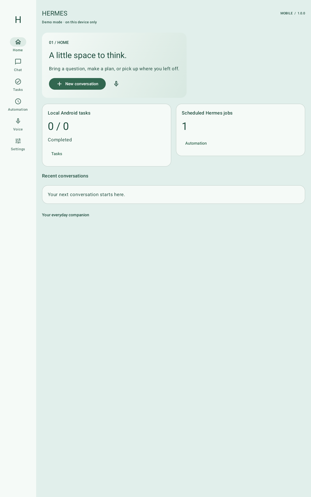

# Signal Grove — 1.1.0-beta.3 preview

Original code-native orbital-garden pixel art, stepped panels and navigation icons with readable native text. These are actual screenshots of the tested app in labelled Demo mode. The narrow capture is Android 8/API 26 at 720×1280, density 320 and 130% font. The phone capture is Android 16/API 36 at 1080×2400, density 420. Motion is paused in these still images; app/system reduced motion is tested separately. Existing explicit palettes remain selectable.

| Starhaven Grove on phone | Narrow screen / 130% text |
| --- | --- |
|  |  |

Wide emulated layout: Android 16/API 36 at 1920×1200, density 240, with navigation rail. Both motion modes and every destination passed; this is a layout check on an owned emulator.

The older stable-release screenshots below document 1.0.0 and retain their original appearance and pre-Signal Grove branding.

# Native Android screenshots — 1.0.0

Captured from the actual tested app; no mockups or image edits. Phone: Android 16/API 36 emulator, 1080×2400/420 dpi. Demo fixtures contain no real server credentials or conversations. The import review is from the signed production package using one synthetic task. Earlier `chat-demo.png`/`tasks.png` remain historical snapshots; current release evidence is below.

| Lavender | Jade | Solar | Mint |
| --- | --- | --- | --- |
|  |  |  |  |

| Explicit Demo approval | Persisted tool activity | Foreground voice | Automation |
| --- | --- | --- | --- |
|  |  |  |  |

| 130% system text / English-Chinese-pinyin | Signed production task import review |
| --- | --- |
|  |  |

Tablet viewport: the API-36 emulator resized to 1600×2560/240 dpi, with navigation rail. This is an emulated layout check, not physical tablet hardware.

