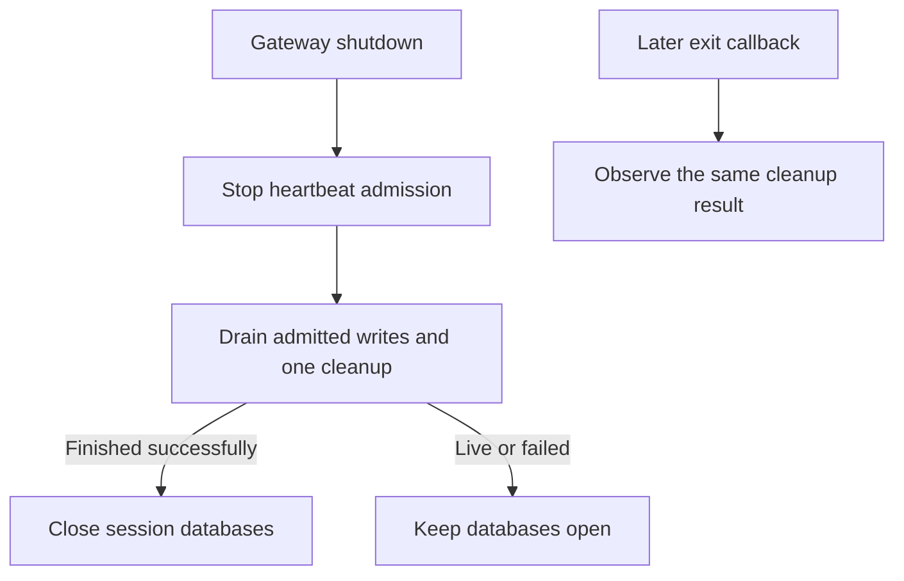

# Experimental Hermes lifecycle candidate

This directory contains a reviewed two-file candidate patch for exact Hermes
`3b421578588243f920886e6fe79a6faa87ea026e`. It addresses a heartbeat cleanup write
after gateway shutdown closes shared SessionDB handles. It is experimental test
material, **not installed on a live gateway** and not bundled into the Android
APK. Unmodified upstream acceptance and the full Signal Grove audit remain open.

The candidate closes heartbeat admission, tracks synchronous/periodic writes,
drains its one cleanup attempt and clears captured registrations before the
gateway closes any session DB. A live or failed cleanup keeps the close gate
closed. Exit callbacks observe the same completed attempt without reopening a
handle or replaying a failed write. Register-once mode remains nonperiodic.



`scripts/hermes_heartbeat_candidate.py` reads the exact base's Git blobs into a
fresh scratch snapshot, applies only the checksum-pinned patch, then verifies
every source file. It refuses a dirty/wrong base, extra/missing/changed files,
ambiguous paths, reparse points and a reused output. Base checkout and live
services are never modified. Git blob materialization avoids archive/checkout
EOL filters. All Windows SDK/scratch paths must use E:.

## Reproduce the helper regressions

Use an existing dependency environment and a clean immutable checkout of the
exact base. Set TEMP/TMP to your approved scratch directory. Substitute your
own absolute paths; keep the output fresh and outside the SDK checkout.

```text
python -B scripts/hermes_heartbeat_candidate.py prepare --base-root <SDK_BASE> --output <FRESH_CANDIDATE>
python -I -S -B scripts/compatibility_probe_heartbeat_lifecycle.py --base-root <SDK_BASE> --source-root <FRESH_CANDIDATE>/source --dependency-site <EXISTING_SITE_PACKAGES> --work-root <FRESH_FIXTURE_OUTPUT>
```

The second command verifies the entire candidate before loading SDK code. Its
eight tests use the real patched helpers, official binding mechanism and SQLite
with an explicit synthetic server/callback registry and controlled blocked/
failed fixture writes. It refuses network, subprocesses and outside writes.
Its positive result is **not full native owner-runtime or deployed acceptance**.
Failed roots/receipts are retained; inspect them before making a new trial.

Separate private native trials exercised actual owner bootstrap, tickets,
profile isolation, room reads, process exit and real SQLite contention without
runtime SDK function replacement. Those exact-source trial details belong in
the audit evidence; do not substitute the helper test for the broader gate.
The unmodified owner probe still reports the original shutdown finding. A
supported reproducible candidate mode for that probe is the next integration
step. No source guards, warnings or callbacks have been waived or suppressed.

The patch is derived from Nous Research's MIT-licensed Hermes Agent source.
See [the upstream notice](NOUS_RESEARCH_LICENSE) and the repository's
[original-code licence](../LICENSE). No upstream issue, PR or deployment is
performed by these tools.
